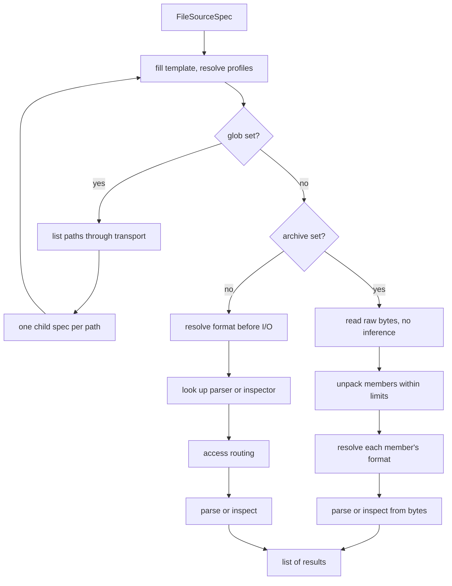
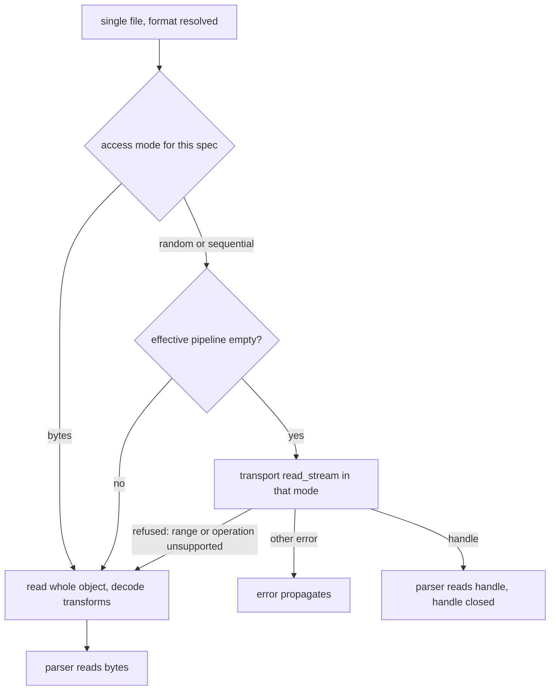

# How mountainash-files works

mountainash-files is a thin layer between three things it does not own: storage, reached through mountainash-transport; format engines such as pyarrow, polars and fastexcel; and the caller's data. The package's own code decides which file to read, which format interprets it, how the parser receives its bytes, and what shape the result takes. That machinery, and the invariants that keep it safe to change, live mostly in `src/mountainash_files/_operations.py` and `src/mountainash_files/formats/_registry.py`.

The examples register small test formats. Each code block continues from the one before it.

## The read pipeline

<!-- concept:107 -->

`parse` and `inspect_schema` share one traversal, `_read_source` in `src/mountainash_files/_operations.py`. Each operation passes it a factory that, given a format key and spec, looks up the format's parser (or schema inspector) and returns two callbacks: one for in-memory bytes, used for archive members, and one for a single file at a path. The lookup happens inside the factory, before any storage access, so an unsupported operation fails without touching the file: `inspect_schema` on XML raises `SchemaDiscoveryUnsupportedError` without reading anything.

For one `FileSourceSpec` the traversal runs these steps:

1. Fill the path template from `params` with `str.format`.
2. Materialise the spec's profiles: a named storage profile is resolved through mountainash-transport, an explicit `auth_profile` replaces the one the name resolved to, and the location policy is carried alongside. This happens once; glob children receive the resolved objects.
3. With `glob` set, list matching paths through transport and run the traversal again for each one, with `glob` cleared ([Globs](../selecting-files/index.md#globs)).
4. With `archive` set, read the archive's raw bytes with suffix inference off (the archive does its own decompression), unpack the members within the decompression limits, resolve each member's format, and parse each member from bytes ([ZIP archives](../selecting-files/index.md#zip-archives)).
5. Otherwise resolve the format from the spec or the path suffix, then acquire and parse the file through [access routing](#access-routing).

A missing file is caught at step 4 or 5. With `on_missing="skip"` that input contributes no result; otherwise transport's `PathNotFoundError` propagates.



Format resolution before I/O is observable: an unknown suffix fails with `UnknownFormatError` even when the directory does not exist, while a known suffix reaches storage and fails there.

```python
from mountainash_files import FileSourceSpec, UnknownFormatError, parse

try:
    parse(FileSourceSpec("/no/such/dir/data.unknown"))
except UnknownFormatError as exc:
    print(type(exc).__name__, exc.path)

try:
    parse(FileSourceSpec("/no/such/dir/data.csv"))
except Exception as exc:
    print(type(exc).__name__)
```

```text
UnknownFormatError /no/such/dir/data.unknown
PathNotFoundError
```

`write` follows the same order without the selection steps: fill the template, resolve profiles, resolve the format, look up the serialiser (a read-only format raises `WriteError` here), and only then read the destination for an append or serialise and write. Raw `bytes` skip format handling. `copy` and `stream` never resolve a format.

<!-- concept:108 -->

### Access routing

For a single file, `_with_access` decides whether the parser receives a handle or bytes. It asks the registry for the format's [access mode](../custom-formats/index.md#access-mode-registration) for this spec, then:

- If the mode is `"random"` (or `"sequential"` for schema discovery) and no transform applies, it opens a stream through transport's `StorageFacade.read_stream` in that mode and passes the handle to the parser. The handle is closed when the parser returns or raises.
- If transport refuses the mode with `RangeNotSupportedError` or `UnsupportedOperationError`, it falls back to reading the whole object. Any other error, such as `PathNotFoundError`, propagates without a second request (`tests/test_access_routing.py::test_non_capability_error_propagates_without_whole_object_retry`).
- If the mode is `"bytes"`, or a transform applies, the parser receives the whole decoded object as `bytes`.

"A transform applies" means the effective pipeline is not empty: an explicit `transforms` pipeline that has stages, or, when inference is on, a pipeline that transport infers from the path's suffixes (`.gz`, `.gpg`). If inference itself fails, for example a `.gpg` path with no GPG configured, routing takes the bytes path, so transport applies the location policy before reporting the real error. Range read-ahead is not set here: files passes no range policy, so the storage profile's `RANGE_*` settings govern (`tests/test_access_routing.py::test_profile_range_settings_govern_parse`).



A format that reports how it was called shows the two routes on a local file. The plain file arrives as a handle the parser can seek; the gzip file arrives as decoded bytes:

```python
import dataclasses
import gzip
import tempfile
from typing import ClassVar

from mountainash_files import FileSinkSpec, FormatSpec, register_format, write


@dataclasses.dataclass(frozen=True)
class TailSpec(FormatSpec):
    """Reports how the parser received its input, and the input's last bytes."""

    FORMAT: ClassVar[str] = "tail"
    SUFFIXES: ClassVar[tuple[str, ...]] = (".tail",)
    TABULAR: ClassVar[bool] = False


def tail_parse(data, spec):
    if isinstance(data, bytes):
        return "bytes", data[-5:]
    data.seek(-5, 2)
    return "handle", data.read()


register_format(TailSpec, tail_parse, access="random")

with tempfile.TemporaryDirectory() as tmp:
    write(FileSinkSpec(f"{tmp}/log.tail"), b"first line\nlast line\n")
    write(FileSinkSpec(f"{tmp}/log.tail.gz"), gzip.compress(b"first line\nlast line\n"))
    print(parse(FileSourceSpec(f"{tmp}/log.tail"))[0].data)
    print(parse(FileSourceSpec(f"{tmp}/log.tail.gz"))[0].data)
```

```text
('handle', b'line\n')
('bytes', b'line\n')
```

`tests/test_access_routing.py` covers the remaining routes against a local HTTP server: ranged reads over HTTP, a server without range support, explicit and empty pipelines, handle closing after a parser failure, and `on_missing="skip"` on both routes.

## One output seam

<!-- concept:109 -->

Parsers return their format's natural type, and one function, `_normalise_output` in `src/mountainash_files/_operations.py`, turns that into what the caller asked for with `output=` ([Arrow or Python records](../reading-and-writing/index.md#arrow-or-python-records)). It is applied at all three places a parser is called: each archive member, a single file in `parse`, and `parse_bytes`. No parser looks at `output=`, and no other code converts results.

| Parser returns | `output="arrow"` | `output="pydata"` |
|---|---|---|
| `pyarrow.Table` | unchanged | `table.to_pylist()` |
| `dict` | one-row table | unchanged |
| list of dicts | table; keys are unioned in first-seen order, missing keys become nulls | unchanged |
| empty list | table with no rows and no columns | unchanged |
| list containing a non-dict | `ParseError` | unchanged |
| anything else | `ParseError` | unchanged |
| any value from a format with `TABULAR = False` | unchanged | unchanged |

A test format whose parser returns whatever `json.loads` produces shows each row of the table:

```python
import json

from mountainash_files import ParseError, parse_bytes


@dataclasses.dataclass(frozen=True)
class DecodedSpec(FormatSpec):
    """A tabular test format whose parser returns whatever json.loads returns."""

    FORMAT: ClassVar[str] = "decoded"
    SUFFIXES: ClassVar[tuple[str, ...]] = (".decoded",)


def decoded_parse(data, spec):
    return json.loads(data if isinstance(data, bytes) else data.read())


register_format(DecodedSpec, decoded_parse)

for payload in (b'{"id": 1}', b'[{"id": 1}, {"id": 2, "note": "x"}]', b"[]"):
    table = parse_bytes(payload, "decoded").data
    print(type(table).__name__, table.num_rows, table.column_names)

for payload in (b"[1, 2]", b'"text"'):
    try:
        parse_bytes(payload, "decoded")
    except ParseError as exc:
        print(exc)

print(parse_bytes(b"[1, 2]", "decoded", output="pydata").data)
print(type(parse_bytes(b"<rows><row id='1'/></rows>", "xml").data).__name__)
```

```text
Table 1 ['id']
Table 2 ['id', 'note']
Table 0 []
[decoded] non-record JSON array is not tabular; expected an array of objects
[decoded] payload type str is not normalisable to Arrow
[1, 2]
_Element
```

The seam does not reconcile schemas across results: each glob match or archive member is normalised on its own, and combining them is the caller's job. Schema discovery and writing do not pass through it. Because every format's `output=` behaviour depends on this one function, changes to it are covered by `tests/test_output_normalisation.py`, which runs each case through `parse_bytes` and through `parse` on plain and gzip paths.

## Inside the registry

<!-- concept:110 -->

The registry in `src/mountainash_files/formats/_registry.py` is a set of module-level dictionaries keyed by format key: spec classes, parsers, serialisers, access modes, schema inspectors and schema access modes. Two more map suffixes and media types to their owning key, one holds per-suffix spec overrides, and one records entry points that failed to load. A single re-entrant lock (`threading.RLock`) guards every read and write. It has to be re-entrant because entry-point discovery holds the lock while it imports plugin modules, and those imports call `register_format` on the same thread (`tests/test_registry_lazy.py::test_reentrant_lock_registration_during_resolution`).

`resolve_format(path, format, mediatype)` applies the precedence described in [How a format is chosen](../files-specs-and-formats/index.md#how-a-format-is-chosen): an explicit key, then a media type (exact match, then the base type of a structured suffix such as `+json`), then path suffixes from the last one backwards, skipping transform suffixes. It returns the key and the suffix that matched, so callers can apply that suffix's overrides when they construct the spec.

Lazy references are stored as strings. The getters (`get_spec_class`, `get_parser`, `get_serialiser`, `get_schema_inspector`) import a string reference on first use, replace it with the resolved object, and wrap import failures in `FormatResolutionError`. A serialiser or inspector stored as `None` means "none registered", which callers turn into `WriteError` or `SchemaDiscoveryUnsupportedError`. Access modes are evaluated on every call, because a callable mode depends on the spec instance, and a callable that returns a value outside the allowed set raises `ValueError`.

The registry has no public read API. Extension code registers through `register_format` and observes the result through the operations, as the examples on [Custom formats and plugins](../custom-formats/index.md) do. The getters are internal and may change.

<!-- concept:111 -->

### Registration bootstrap

Registration happens as a side effect of importing the package:

1. `import mountainash_files` imports `_operations`, which imports the registry module. Importing any module in `mountainash_files.formats` first runs the package's `formats/__init__.py`.
2. `formats/__init__.py` imports the six built-in format modules. Each ends with its own module-level `register_format` call.
3. It then calls `_discover_entrypoint_formats()`, which imports every module in the `mountainash_files.formats` entry-point group once, behind a latch, recording failures instead of raising them.
4. Control returns to `mountainash_files/__init__.py`, which binds the public names.

Plugins therefore load before the package root has bound `register_format`, which is why an entry-point module imports it from `mountainash_files.formats._registry` ([Entry-point plugins](../custom-formats/index.md#entry-point-plugins)). Discovery runs once per process; a plugin installed after import is not seen until the next process.

Tests isolate registrations with `_reset_registry()`, which clears every table and the discovery latch and re-registers the built-ins through `_register_builtin_formats()`. That function repeats the arguments of each format module's own `register_format` call, so a change to a built-in registration has to be made in both places. `tests/test_serialisers.py::test_tsv_initial_registration_and_reset` checks that TSV behaves the same before and after a reset.

## Package invariants

Three rules hold across the package. Each is enforced by configuration or a test rather than by convention.

<!-- concept:112 -->

### Storage boundary

mountainash-files never touches storage itself. Every read, write, listing and stream goes through the `mountainash_transport` package root, mostly through `StorageFacade` and `infer_pipeline`, so local disk, HTTP, S3 and the other backends behave the same and location policies, credentials and transforms are applied in one place (see the [mountainash-transport documentation](https://docs.mountainash.io/mountainash-transport/)). Glob listing in `src/mountainash_files/_glob.py` also goes through transport. The archive and workbook code in `src/mountainash_files/_archives.py` works only on bytes already in memory.

ruff enforces the boundary. `pyproject.toml` selects `TID251` (banned APIs) and `PTH123` (builtin `open()`), and its `[tool.ruff.lint.flake8-tidy-imports.banned-api]` table bans:

| Banned | Examples |
|---|---|
| Filesystem access | `pathlib.Path` and its concrete subclasses, `io.open`, `os.open`, `os.stat`, `os.listdir`, `os.walk`, `os.makedirs`, `os.remove`, `os.replace`, `os.path.exists`, `shutil`, `glob` |
| Network and cloud SDKs | `urllib.request`, `requests`, `httpx`, `boto3`, `botocore`, `paramiko`, `fsspec`, `google.cloud.storage`, `azure.storage` |
| Arrow file I/O | `pyarrow.OSFile`, `pyarrow.memory_map`, `pyarrow.fs` |
| Transport internals | `mountainash_transport._core`, `.connections`, `.messaging`, `.settings`, `.storage` |

`PurePosixPath` stays allowed for string handling; the registry uses it to split suffixes. The CI workflow runs `hatch run ruff:check`, which uses the ruff version pinned in `hatch.toml`. A module that reaches for storage directly fails the check:

```python title="reader.py"
from pathlib import Path

from mountainash_transport.storage import StorageFacade


def read(path: str) -> bytes:
    with open(path, "rb") as handle:
        return handle.read()
```

```console
$ uvx ruff@0.3.7 check --config pyproject.toml --select TID251,PTH123 --output-format concise reader.py
reader.py:1:21: TID251 `pathlib.Path` is banned: storage access goes through mountainash_transport (PurePosixPath is fine for string handling)
reader.py:3:1: TID251 `mountainash_transport.storage` is banned: import from the mountainash_transport package root only
reader.py:7:10: PTH123 `open()` should be replaced by `Path.open()`
Found 3 errors.
```

PTH123's own hint suggests `Path.open()`, which is banned too; the rule is selected only because it is ruff's check for builtin `open()`.

<!-- concept:113 -->

### Lazy imports

Importing `mountainash_files` must not import the libraries behind the [optional extras](../files-specs-and-formats/index.md#where-files-live) or the storage SDKs. The XLSX reader imports fastexcel and openpyxl inside its parse function and raises `MissingDependencyError` when they are missing; the XML reader imports lxml on first use and falls back to the standard library; JSON imports polars inside its parser; cloud SDKs load inside mountainash-transport only when a backend needs them. pyarrow is a core dependency and is imported at package import. `tests/test_lazy_imports.py` checks the rule in a fresh interpreter:

```python
import subprocess
import sys

check = (
    "import sys, mountainash_files; "
    "print(sorted({'polars', 'fastexcel', 'openpyxl', 'lxml', 'boto3', 'paramiko'} & set(sys.modules)))"
)
print(subprocess.run([sys.executable, "-c", check], capture_output=True, text=True).stdout)
```

```text
[]

```

The same rule applies to [plugin entry-point modules](../custom-formats/index.md#import-light-plugin-modules), which are imported with the package.

<!-- concept:120 -->

### Version source

The package version has one source: `src/mountainash_files/__version__.py`. `hatch.toml` points the build at that file (`[version] path`), and `pyproject.toml` declares the version dynamic, so the wheel's metadata always matches it. The package root does not import the module, so `mountainash_files.__version__` is not set after `import mountainash_files`. `from mountainash_files import __version__` imports the submodule rather than a string. Read the installed version from package metadata:

```python
from importlib.metadata import version

from mountainash_files import __version__

print(type(__version__).__name__, __version__.__version__)
print(version("mountainash-files"))
```

```text
module 0.1.0
0.1.0
```

`importlib.metadata.version` reports what is installed, which is the value to log or compare against.
