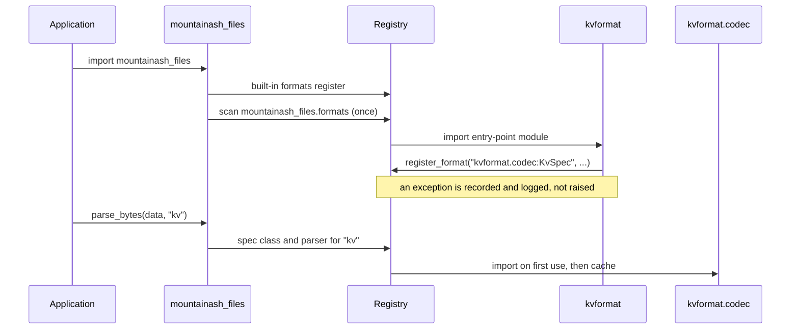

# Custom formats and plugins

A format in mountainash-files is a registry entry: a format key, a `FormatSpec` subclass that carries the format's options, a parser, and optionally a serialiser and a schema inspector. The built-in formats use the same `register_format` call that any application or installed plugin uses, so a format you add takes part in `parse`, `write`, `inspect_schema`, globs, archives and remote storage exactly as CSV or Parquet do.

The examples on this page build one small format, `kv`: one record per line, written as `key=value` pairs joined by `;`. Each code block continues from the one before it.

## Format protocols

A format is a `FormatSpec` subclass plus up to three callables. The spec is a frozen dataclass whose class variables describe the format and whose fields are its options (see [Formats and format specs](../files-specs-and-formats/index.md#formats-and-format-specs)). The class variables an author sets are:

| Class variable | Default | Effect |
|---|---|---|
| `FORMAT` | required | The format key. Must be lowercase. |
| `SUFFIXES` | required | Path suffixes that select the format, such as `(".kv",)`. |
| `MEDIATYPES` | `()` | Media types that select the format when a caller resolves by content type. |
| `TABULAR` | `True` | Whether parse output is normalised to Arrow or records. See [Format capability flags](../format-options/index.md#format-specs-as-options). |
| `APPENDABLE` | `False` | Whether `write_disposition="append"` is allowed. Append also requires `TABULAR` and a parser that returns a `pyarrow.Table`. |
| `COMPLEX_HANDLER_KEY` | `None` | See [Complex formats and treespec](#complex-formats-and-treespec). |

The fields need no extra code: `to_options()` and `from_options()` work for any frozen dataclass subclass, as described in [Format specs as options](../format-options/index.md#format-specs-as-options).

<!-- concept:98 -->

`FormatParser` is the shape of a parser: `parser(data, spec)`, where `data` is `bytes` or a binary stream and `spec` is the resolved spec instance. It returns the format's natural Python object. A tabular parser can return a `pyarrow.Table`, a list of record dicts or a single dict; the [output seam](../architecture/index.md#one-output-seam) converts that to the shape the caller asked for, so the parser never looks at `output=`. A parser must accept both `bytes` and a stream, because archives, transforms and in-memory calls always pass `bytes` while the [access mode](#registering-a-format) can pass a stream. Raise `ParseError(spec.FORMAT, message)` for malformed input so callers see one error type for every format.

<!-- concept:99 -->

`FormatSerialiser` is `serialiser(data, spec) -> bytes`. It receives whatever the caller passed to `write` or `serialise_bytes`: a `pyarrow.Table`, a list of dicts, or for a non-tabular format its own object type. Without a serialiser the format is read-only.

<!-- concept:100 -->

`FormatSchemaInspector` is `inspector(data, spec, *, infer_schema_rows=None) -> (pyarrow.Schema, basis)`, where `basis` is `"metadata"`, `"full"` or `"bounded"` as described in [How a schema was obtained](../schema-discovery/index.md#how-a-schema-was-obtained). It must handle `bytes` and a stream, and must not close a stream it was given. Without an inspector, `inspect_schema` raises `SchemaDiscoveryUnsupportedError` for the format before reading anything.

The three protocols are `typing.Protocol` classes exported from the package root, so a type checker can verify your callables against them. They are structural: nothing has to inherit from them.

```python
import dataclasses
from typing import ClassVar

import pyarrow as pa

from mountainash_files import FormatSpec, ParseError


@dataclasses.dataclass(frozen=True)
class KvSpec(FormatSpec):
    """One record per line, as key=value pairs joined by a separator."""

    FORMAT: ClassVar[str] = "kv"
    SUFFIXES: ClassVar[tuple[str, ...]] = (".kv",)
    MEDIATYPES: ClassVar[tuple[str, ...]] = ("text/x-kv",)

    separator: str = ";"
    encoding: str = "utf-8"


def kv_parse(data, spec: KvSpec) -> list[dict[str, str]]:
    raw = data if isinstance(data, bytes) else data.read()
    records = []
    for number, line in enumerate(raw.decode(spec.encoding).splitlines(), start=1):
        if not line:
            continue
        try:
            records.append(dict(pair.split("=", 1) for pair in line.split(spec.separator)))
        except ValueError:
            raise ParseError(spec.FORMAT, f"line {number} is not key=value pairs") from None
    return records


def kv_serialise(data, spec: KvSpec) -> bytes:
    rows = data.to_pylist() if isinstance(data, pa.Table) else data
    lines = [
        spec.separator.join(f"{key}={value}" for key, value in row.items() if value is not None)
        for row in rows
    ]
    return "".join(line + "\n" for line in lines).encode(spec.encoding)


def kv_inspect_schema(data, spec: KvSpec, *, infer_schema_rows=None):
    records = kv_parse(data, spec)
    used = records if infer_schema_rows is None else records[:infer_schema_rows]
    basis = "full" if len(used) == len(records) else "bounded"
    return pa.Table.from_pylist(used).schema, basis
```

`kv_inspect_schema` parses the whole input and then keeps the first rows, which is correct but not cheap. An inspector for a large format should stop reading once it has `infer_schema_rows` records, as the built-in CSV and NDJSON inspectors do; [`schema_access`](#access-mode-registration) is how it asks for a stream it can stop reading.

## Registering a format

<!-- concept:97 -->

`register_format(spec_cls, parser, ...)` adds a format to the process-wide registry. From then on the format key works anywhere a format is accepted, and the suffixes select it from a path. Registration validates everything first and then changes the registry in one step, so a rejected call leaves no partial state (`tests/test_registry_lazy.py::test_atomic_registration_no_partial_state`).

| Parameter | Default | Meaning |
|---|---|---|
| `spec_cls` | required | The `FormatSpec` subclass, or a `"package.module:Class"` reference ([lazy registration](#lazy-registration-and-plugins)). |
| `parser` | required | The parser, or a dotted reference to it. |
| `format_key` | `spec_cls.FORMAT` | The key. Must be lowercase; user input is lowercased before lookup. |
| `suffixes` | `spec_cls.SUFFIXES` | Each must start with `.`; stored lowercase. |
| `mediatypes` | `spec_cls.MEDIATYPES` | Stored lowercase. |
| `serialiser` | `None` | `None` makes the format read-only. |
| `schema_inspector` | `None` | `None` makes schema discovery unsupported. |
| `access` | `"bytes"` | How `parse` hands the parser its input. See [Access mode registration](#access-mode-registration). |
| `schema_access` | `"bytes"` | How `inspect_schema` hands the inspector its input. |
| `suffix_overrides` | `None` | Spec field values to apply when a path resolved through a given suffix, as JSON uses for `.ndjson` ([JSON and NDJSON](../format-options/index.md#json-and-ndjson)). |
| `override` | `False` | Replace an existing registration. See [Registration override](#registration-override). |

Register `kv` with all three callables and it works with the in-memory functions:

```python
from mountainash_files import parse_bytes, register_format

register_format(KvSpec, kv_parse, serialiser=kv_serialise, schema_inspector=kv_inspect_schema)

result = parse_bytes(b"site=A1;status=open\nsite=B2;status=closed\n", "kv")
print(result.format_key, type(result.spec).__name__)
print(result.data.to_pylist())
```

```text
kv KvSpec
[{'site': 'A1', 'status': 'open'}, {'site': 'B2', 'status': 'closed'}]
```

`kv_parse` returned a list of dicts and `result.data` is a `pyarrow.Table`, because the seam normalised it. The same registration drives the path-based operations. The `.kv` suffix selects the format for writing and reading, `inspect_schema` uses the inspector, and the parsed table converts to any other format:

```python
import tempfile

from mountainash_files import FileSinkSpec, FileSourceSpec, inspect_schema, parse, write

with tempfile.TemporaryDirectory() as tmp:
    rows = [{"site": "A1", "status": "open"}, {"site": "B2", "status": "closed", "note": "flood"}]
    write(FileSinkSpec(f"{tmp}/sites.kv"), rows)

    [result] = parse(FileSourceSpec(f"{tmp}/sites.kv"))
    print(result.data.column_names, result.data.num_rows)

    [found] = inspect_schema(FileSourceSpec(f"{tmp}/sites.kv"), infer_schema_rows=1)
    print(found.basis, found.schema.names)

    write(FileSinkSpec(f"{tmp}/sites.parquet"), result.data)
```

```text
['site', 'status', 'note'] 2
bounded ['site', 'status']
```

Parse errors carry the format key like the built-in ones:

```python
try:
    parse_bytes(b"site A1\n", "kv")
except ParseError as exc:
    print(exc)
```

```text
[kv] line 1 is not key=value pairs
```

<!-- concept:103 -->

### Registration override

A registration owns its key, its suffixes and its media types. `override=True` replaces the whole entry for the key: parser, serialiser, inspector and access modes all come from the new call, and anything the new call leaves out takes its default. The old entry's suffixes and media types are released (`tests/test_registry_lazy.py::test_override_cleans_old_suffixes_and_mediatypes`). Overriding `kv` with only a parser and a new suffix therefore makes it read-only and stops `.kv` paths from resolving:

```python
from mountainash_files import UnknownFormatError, WriteError, serialise_bytes

register_format(KvSpec, kv_parse, suffixes=(".kvp",), override=True)

try:
    serialise_bytes([{"site": "A1"}], "kv")
except WriteError as exc:
    print(exc)

try:
    write(FileSinkSpec("/tmp/not-written.kv"), [{"site": "A1"}])
except UnknownFormatError as exc:
    print(type(exc).__name__, exc.path)

register_format(
    KvSpec, kv_parse, serialiser=kv_serialise, schema_inspector=kv_inspect_schema, override=True
)
print(serialise_bytes([{"site": "A1"}], "kv"))
```

```text
No serialiser registered for format 'kv'
UnknownFormatError /tmp/not-written.kv
b'site=A1\n'
```

The `write` call failed while resolving the format, before any storage access, so nothing was created. `override=True` also lets a format take a suffix or media type that another format owns, and lets a registration replace a built-in format. The built-in registrations run when the package is imported, so an override made later in the process wins.

<!-- concept:92 -->

### FormatConflictError

Without `override=True`, `register_format` raises `FormatConflictError` when the key is already registered, or when a suffix or media type belongs to a different format. The message names what is taken and by whom:

```python
from mountainash_files import FormatConflictError

try:
    register_format(KvSpec, kv_parse)
except FormatConflictError as exc:
    print(exc)


@dataclasses.dataclass(frozen=True)
class PropsSpec(FormatSpec):
    FORMAT: ClassVar[str] = "props"
    SUFFIXES: ClassVar[tuple[str, ...]] = (".props", ".kv")


try:
    register_format(PropsSpec, kv_parse)
except FormatConflictError as exc:
    print(exc)
```

```text
Format 'kv' already registered. Pass override=True to replace.
Suffix '.kv' already owned by format 'kv'. Pass override=True to replace.
```

The second call registered nothing, not even `.props`. Invalid arguments, such as an uppercase key or a suffix without a leading dot, raise `ValueError` instead. `FormatConflictError` is a `FormatError`; see [Format errors](../errors/index.md#format-errors) for the rest of the hierarchy.

<!-- concept:104 -->

### Access mode registration

`access` decides what `parse` passes to the parser when it reads a single file. It is one of:

- `"bytes"` (the default): the whole decoded object as `bytes`.
- `"random"`: a seekable, ranged handle from mountainash-transport, so the parser can read part of a large remote object. Parquet uses this to fetch only the footer and the projected columns.
- A callable of the spec that returns `"bytes"` or `"random"`, so the choice can depend on options. The built-in Parquet registration returns `"random"` only when `ParquetSpec.columns` is set.

`"random"` is a request, not a guarantee. When a transform applies (a `.gz` suffix or an explicit pipeline) or the backend cannot serve ranges, the parser receives `bytes`. Archive members and `parse_bytes` input are always `bytes`. A parser registered as `"random"` must therefore handle both, and must finish reading before it returns, because the handle is closed afterwards. [How mountainash-files works](../architecture/index.md#the-read-pipeline) shows the routing.

`schema_access` is the same choice for schema discovery, with one more value: `"sequential"`, a forward-only stream for inspectors that stop after the first `infer_schema_rows` records. As a callable it receives the spec and the row budget. The built-in CSV inspector asks for `"sequential"` only when a budget is set.

The stream access modes and range settings themselves belong to mountainash-transport; see [Stream access](../storage-and-transforms/index.md#stream-access).

## Lazy registration and plugins

<!-- concept:101 -->

Every callable argument of `register_format` can be a `"package.module:attribute"` string instead of an object. The registry checks the string's shape when you register, and imports the module only when the format is first used; the resolved object is cached for later calls. A lazy registration must pass `format_key` and `suffixes`, because the registry cannot read them from a class it has not imported.

A reference that cannot be imported fails at use time with `FormatResolutionError`, which names the format, the reference and the field that failed:

```python
from mountainash_files import FormatResolutionError

register_format(
    "kv_missing.codec:KvSpec",
    "kv_missing.codec:kv_parse",
    format_key="kvmissing",
    suffixes=(".kvm",),
)

try:
    parse_bytes(b"site=A1\n", "kvmissing")
except FormatResolutionError as exc:
    print(exc.format_key, exc.field, exc.ref)
```

```text
kvmissing spec_cls kv_missing.codec:KvSpec
```

The spec class is resolved first, because every operation constructs the spec before it parses. Lazy registration is how a plugin keeps its startup cost at zero, as shown next.

<!-- concept:102 -->

### Entry-point plugins

An installed package can add formats without the application importing it. mountainash-files scans the `mountainash_files.formats` [entry-point group](https://packaging.python.org/en/latest/specifications/entry-points/) once per process, while the package is being imported, and imports each entry point's module. The module's top-level `register_format` calls do the registering. The entry-point name is only a label used in failure reports; the value is the module to import.

A plugin package declares the entry point in its `pyproject.toml`:

```toml
[project]
name = "kvformat"
version = "0.1.0"
dependencies = ["mountainash-files", "pyarrow>=23.0.1"]

[project.entry-points."mountainash_files.formats"]
kv = "kvformat"
```

The entry-point module, `kvformat/__init__.py`, registers by reference:

```python title="kvformat/__init__.py"
from mountainash_files.formats._registry import register_format

register_format(
    "kvformat.codec:KvSpec",
    "kvformat.codec:kv_parse",
    format_key="kv",
    suffixes=(".kv",),
    mediatypes=("text/x-kv",),
    serialiser="kvformat.codec:kv_serialise",
    schema_inspector="kvformat.codec:kv_inspect_schema",
)
```

`kvformat/codec.py` holds `KvSpec` and the three functions from [Format protocols](#format-protocols), unchanged. Once the package is installed, any process that imports mountainash-files can use the format; `kvformat.codec` is imported on the first `kv` operation, not at startup.

!!! note "Import `register_format` from `mountainash_files.formats._registry` in an entry-point module"
    Discovery runs while `mountainash_files` is still initialising, so an entry-point module cannot import from the package root: `from mountainash_files import register_format` fails there with `ImportError` (a partially initialised module), and the plugin is recorded as failed. Import `register_format` from `mountainash_files.formats._registry`, the module the built-in formats register through. Modules that are imported later, such as `kvformat.codec` above, can import `FormatSpec` and `ParseError` from the package root.

Discovery imports plugins in sorted order and isolates failures. If a plugin's import raises, including a `FormatConflictError` from its registration, the error is logged as a warning on the `mountainash_files.formats._registry` logger and recorded, and the other plugins still load. Every later `UnknownFormatError` lists the failed plugins and their errors in its message and in `failed_plugins`, because a plugin that failed to load is the likely owner of the format the caller asked for (`tests/test_entrypoint_discovery.py::test_failed_plugin_is_isolated_and_surfaced`). Built-in formats register before discovery, so a plugin can only take a built-in key or suffix with `override=True`.



<!-- concept:105 -->

### Import-light plugin modules

Every entry-point module is imported whenever mountainash-files is imported, by every process, whether or not it uses the format. An entry-point module must therefore be import-light: it registers with dotted references, or defines only the spec class (a frozen dataclass) at module level, and imports heavy dependencies such as pyarrow, polars or a vendor SDK inside the codec module or inside function bodies. A heavy entry-point module does not break parsing, but it adds its import time to every process. The package holds itself to the same rule; see [Package invariants](../architecture/index.md#package-invariants).

Resolving a format by suffix or key constructs its spec, so a lazily registered spec class is imported at the first operation that uses the format. Keep the module that defines it cheap to import as well.

## Complex formats and treespec

<!-- concept:106 -->

`COMPLEX_HANDLER_KEY` is a class variable on `FormatSpec`, `None` by default and on every built-in format. A format that holds a nested document rather than a table (`TABULAR = False`, as XML does) can set it to advertise that a complex-format handler exists for it under that key. The handler registry belongs to mountainash-treespec, which is the authority on whether a handler is actually available; the value on the spec is only the link between the two packages.

mountainash-files never reads `COMPLEX_HANDLER_KEY`. It does not change parsing, the output seam or any error, and `TABULAR` is not a substitute for it: `TABULAR` only controls output normalisation. Consumers that route non-tabular data, such as mountainash, read both flags from the resolved spec class. Set it on a custom non-tabular format when a treespec handler for that format exists; leave it `None` otherwise.

```python
from mountainash_files.formats.xml import XmlSpec

print(FormatSpec.COMPLEX_HANDLER_KEY, XmlSpec.TABULAR, XmlSpec.COMPLEX_HANDLER_KEY)
```

```text
None False None
```
