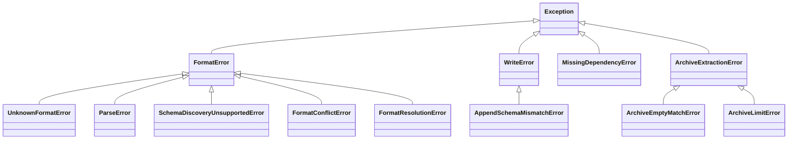

# Errors and troubleshooting

mountainash-files raises its own exceptions for format, parsing, writing, missing-extra and archive problems. Each entry below gives the trigger, the message as the package prints it, and the fix, with a link to the section that explains the cause. All the exception classes are importable from the package root, except the archive errors (see [Archive errors](#archive-errors)).



Some failures come from elsewhere and pass through unchanged:

| Exception | Raised by | Typical cause |
|---|---|---|
| `PathNotFoundError`, `AuthenticationError`, `PermissionDeniedError`, `StorageConnectionError`, `StorageError` | mountainash-transport | The file is missing, credentials are rejected, or the backend fails. The backend's own error is the `__cause__`. `PermissionDeniedError` subclasses `AuthenticationError`, so catch it first. |
| `LocationNotAllowed` | mountainash-transport | A path falls outside the spec's [location policy](../storage-and-transforms/index.md#location-policy). |
| `MissingExtraError` | mountainash-transport | A storage backend's extra is not installed ([Missing optional dependencies](#missing-optional-dependencies)). |
| `ProfileNotFoundError` | mountainash-transport | A [named profile](../storage-and-transforms/index.md#named-profiles) is not configured. |
| `ValueError` | files or transport | An invalid argument: an `output` other than `"arrow"` or `"pydata"`, an invalid `infer_schema_rows`, a non-positive archive limit, `infer=True` with `transforms`, or a `.gpg` path with no configured `GPG`. |

`on_missing="skip"` absorbs only `PathNotFoundError` for a missing source ([Missing files](../selecting-files/index.md#missing-files)). Every other error still raises.

## Format errors

<!-- concept:89 -->

`FormatError` is the base class for every format problem: resolving a format, parsing content, discovering a schema and registering formats. Catch it to handle all of them in one place. Its subclasses each carry the format key or path involved, so a handler can report which file or format failed.

<!-- concept:90 -->

### UnknownFormatError

Raised when no format can be determined, before any file is read. That happens when the path's suffix is not registered and no `format` is given, or when `format="..."` names a key that does not exist. The message lists the known suffixes. Attributes: `path` (`None` when an explicit key was the problem), `known_suffixes` and `failed_plugins`, the names of entry-point plugins that failed to load, whose errors are appended to the message.

```python
from mountainash_files import FileSourceSpec, FormatError, UnknownFormatError, parse, parse_bytes

try:
    parse(FileSourceSpec(path="exports/sales.dat"))  # the file does not need to exist
except UnknownFormatError as exc:
    print(exc)
    print(exc.path, exc.failed_plugins)

try:
    parse_bytes(b"region,total\nnorth\n", "ndjson")
except FormatError as exc:
    print(type(exc).__name__, exc.path)
```

```text
Cannot determine format from path='exports/sales.dat'. Known suffixes: .csv, .tsv, .tab, .json, .ndjson, .jsonl, .geojson, .parquet, .pq, .xlsx, .xlsm, .xlsb, .ods, .xml.
exports/sales.dat ()
UnknownFormatError None
```

To fix it, pass `format="csv"` or a format spec on the file spec, or register the format ([How a format is chosen](../files-specs-and-formats/index.md#how-a-format-is-chosen)). `ndjson` is not a format key: use `JsonSpec(ndjson=True)` ([JSON and NDJSON](../format-options/index.md#json-and-ndjson)). In a ZIP archive, a member whose format cannot be resolved raises `ParseError` instead, as described next.

<!-- concept:91 -->

### ParseError

Raised when a parser cannot turn the content into data. The message starts with the format key in brackets, and `format_key` holds it. Common causes:

- empty input (`[csv] Empty input`);
- malformed content, such as inconsistent row widths, invalid JSON, or bytes that are not a Parquet file;
- a `JsonSpec(property=...)` path that does not exist;
- a JSON array of scalars requested as Arrow (use `output="pydata"`, see [Arrow or Python records](../reading-and-writing/index.md#arrow-or-python-records));
- Excel option or container problems, such as both `sheet_name` and `sheet_number`, or a damaged or ambiguous ZIP directory;
- for archives (`format_key` is `"archive"`), a member whose format cannot be resolved, or an archive with no recognised members ([ZIP archives](../selecting-files/index.md#zip-archives)).

```python
from mountainash_files import ParseError, parse_bytes
from mountainash_files.formats.json import JsonSpec

for data, fmt in (
    (b"region,total\nnorth,120\nsouth\n", "csv"),
    (b'{"meta": {}}', JsonSpec(property="rows")),
    (b"[1, 2, 3]", "json"),
    (b"not parquet", "parquet"),
):
    try:
        parse_bytes(data, fmt)
    except ParseError as exc:
        print(exc.format_key, "|", exc)
```

```text
csv | [csv] CSV parse error: Expected 2 columns, got 1: south
json | [json] property 'rows' was not found
json | [json] non-record JSON array is not tabular; expected an array of objects
parquet | [parquet] Parquet magic bytes not found in footer. Either the file is corrupted or this is not a parquet file.
```

The underlying engine error is chained as `__cause__`. A Parquet `ParseError` on a file ending in `.gz` usually means the bytes were not decompressed; see [Compression and encryption transforms](../storage-and-transforms/index.md#compression-and-encryption-transforms).

<!-- concept:82 -->

### SchemaDiscoveryUnsupportedError

Raised by `inspect_schema()` and `inspect_schema_bytes()` for a format with no schema inspector: XML, and plugin formats registered without `schema_inspector=`. The check runs before the file is read, so it raises even with `on_missing="skip"` and a missing file. For archive members it runs after the archive is read. Attributes: `format_key` and `reason`.

```python
from mountainash_files import FileSourceSpec, SchemaDiscoveryUnsupportedError, inspect_schema

try:
    inspect_schema(FileSourceSpec(path="feeds/latest.xml", on_missing="skip"))
except SchemaDiscoveryUnsupportedError as exc:
    print(exc.format_key, "|", exc.reason)
```

```text
xml | the format has no schema inspector
```

Such formats still parse. Use `parse()` and read the schema from the result, or register an inspector ([Registering a format](../custom-formats/index.md#registering-a-format)). See [Schema discovery](../schema-discovery/index.md#inspecting-a-schema) for which formats support it.

### Registry errors

Two more `FormatError` subclasses come from the format registry and concern format authors. `FormatConflictError` is raised when `register_format()` claims a key, suffix or media type another format owns, without `override=True` ([Registering a format](../custom-formats/index.md#registering-a-format)). `FormatResolutionError` is raised at first use when a lazy `"package.module:attr"` registration cannot be imported; it has `format_key`, `ref` and `field` attributes, and the import error is its `__cause__` ([Lazy registration and plugins](../custom-formats/index.md#lazy-registration-and-plugins)).

```python
import dataclasses
from typing import ClassVar

from mountainash_files import (
    FormatConflictError,
    FormatResolutionError,
    FormatSpec,
    parse_bytes,
    register_format,
)


@dataclasses.dataclass(frozen=True)
class LogSpec(FormatSpec):
    FORMAT: ClassVar[str] = "log"
    SUFFIXES: ClassVar[tuple[str, ...]] = (".csv",)


try:
    register_format(LogSpec, lambda data, spec: data)
except FormatConflictError as exc:
    print(exc)

register_format(
    "acme_formats.fixed:FixedSpec", "acme_formats.fixed:parse",
    format_key="fixed", suffixes=(".fixed",),
)
try:
    parse_bytes(b"...", "fixed")
except FormatResolutionError as exc:
    print(exc)
    print(exc.field, type(exc.__cause__).__name__)
```

```text
Suffix '.csv' already owned by format 'csv'. Pass override=True to replace.
Failed to resolve spec_cls for format 'fixed': acme_formats.fixed:FixedSpec
spec_cls ModuleNotFoundError
```

## Write errors

<!-- concept:93 -->

`WriteError` is raised when `write()` or `serialise_bytes()` cannot produce or place the output. Every check behind it runs before the destination is written. The messages:

| Message | Cause and fix |
|---|---|
| `No serialiser registered for format 'xlsx'` | The format is read-only. Excel has no writer; write Parquet or CSV instead ([Excel](../format-options/index.md#excel)). |
| `Format 'csv' does not support append of tabular data.` | Append is only for formats declaring `APPENDABLE` and `TABULAR`, which among built-ins means Parquet ([Replace and append](../write-modes/index.md#replace-and-append)). |
| `Raw-byte append is not supported; supply tabular records` | `bytes`, `bytearray` or `memoryview` with `write_disposition="append"`. Supply a table or records. |
| `Unknown write disposition: 'upsert'` | `write_disposition` must be `"replace"` or `"append"`. |
| `Tabular append requires an Arrow table or record data` | Append input that is not a table, a record dictionary or a list of them. |
| `Cannot normalize append input: ...`, `Cannot combine append tables for ...` | Arrow could not build or combine the append tables. |
| `Cannot serialise csv: ...` | A CSV or TSV value cannot be represented, for example a value equal to the `null_sequence` marker ([CSV](../format-options/index.md#csv)). |

```python
import tempfile

import pyarrow as pa
from mountainash_files import FileSinkSpec, WriteError, write

table = pa.table({"region": ["north"], "total": [120]})

with tempfile.TemporaryDirectory() as root:
    for sink, data in (
        (FileSinkSpec(path=f"{root}/sales.xlsx"), table),
        (FileSinkSpec(path=f"{root}/sales.csv", write_disposition="append"), table),
        (FileSinkSpec(path=f"{root}/sales.parquet", write_disposition="append"), b"raw"),
    ):
        try:
            write(sink, data)
        except WriteError as exc:
            print(exc)
```

```text
No serialiser registered for format 'xlsx'
Format 'csv' does not support append of tabular data.
Raw-byte append is not supported; supply tabular records
```

Not every write failure is a `WriteError`. Passing records instead of a `pyarrow.Table` to the CSV, TSV or Parquet serialiser in replace mode raises `AttributeError` from the serialiser; convert with `pa.Table.from_pylist()` ([Replace and append](../write-modes/index.md#replace-and-append)). A missing parent with `create_path=False` raises transport's `PathNotFoundError`.

<!-- concept:94 -->

### AppendSchemaMismatchError

A `WriteError` subclass raised when appended rows do not match the destination's ordered column names and Arrow types. It carries `path`, `expected_schema` (the destination's) and `actual_schema` (the incoming table's), and the message prints both. The destination is left unchanged.

```python
import tempfile

from mountainash_files import AppendSchemaMismatchError, FileSinkSpec, write

with tempfile.TemporaryDirectory() as root:
    append = FileSinkSpec(path=f"{root}/sales.parquet", write_disposition="append")
    write(append, {"region": "north", "total": 120})
    try:
        write(append, {"region": "south", "total": 95.5})
    except AppendSchemaMismatchError as exc:
        print(str(exc).replace(root, "<root>"))
```

```text
Append schema mismatch for '<root>/sales.parquet': expected region: string
total: int64, got region: string
total: double
```

Typical causes are a column whose incoming values are all `None` (inferred as type `null`), integers against floats, and columns in a different order. Build the incoming table with the destination's schema; [The append schema check](../write-modes/index.md#the-append-schema-check) shows how.

## Missing optional dependencies

<!-- concept:95 -->

`MissingDependencyError` is raised when an operation needs a package from an optional extra that is not installed. It has `feature` and `extra` attributes, and the message gives the install command. Reading or inspecting an Excel workbook without the `[xlsx]` extra (fastexcel and openpyxl) raises it. This run used an environment without that extra:

```python
from mountainash_files import FileSourceSpec, MissingDependencyError, parse

try:
    parse(FileSourceSpec(path="report.xlsx"))
except MissingDependencyError as exc:
    print(exc)
    print(exc.feature, "|", exc.extra)
```

```text
XLSX parsing requires an optional dependency. Install with: pip install 'mountainash-files[xlsx]'
XLSX parsing | xlsx
```

Install the named extra. The workbook's container limits are checked before the dependency, so a damaged or oversized workbook raises `ParseError` or an archive limit error even without the extra. XML does not raise this error: without the `[xml]` extra it falls back to the standard library parser ([XML](../format-options/index.md#xml)). A missing storage extra is reported by mountainash-transport instead, as `MissingExtraError` when the backend is first used: without the HTTP stack, a URL source raises `The [http] extra is required for storage profiles: pip install 'mountainash-transport[http]'`. Install the matching files extra, here `mountainash-files[http]`; [Where files live](../files-specs-and-formats/index.md#where-files-live) lists them.

## Archive errors

<!-- concept:96 -->

Archive errors come from ZIP and gzip extraction and from the Excel container check. There are three classes, defined in `src/mountainash_files/_archives.py`:

| Class | Raised when |
|---|---|
| `ArchiveExtractionError` | The archive cannot be read: an empty input, data that is not a ZIP or gzip file, or corrupt compressed data. Base class of the other two. |
| `ArchiveEmptyMatchError` | No ZIP member matches `ZipArchive.file_pattern`. |
| `ArchiveLimitError` | Extraction would exceed `max_decompressed_bytes` or `max_members` on `ZipArchive`, `GzipCompression` or `XlsxSpec`. The message names the field to raise. |

These classes are not exported from the package root, and they subclass `Exception` directly, not `FormatError`. Catching `FormatError` does not catch them. To handle them separately, catch `Exception` around the read and check the class name:

```python
import tempfile
import zipfile

from mountainash_files import FileSourceSpec, ZipArchive, parse

with tempfile.TemporaryDirectory() as root:
    path = f"{root}/exports.zip"
    with zipfile.ZipFile(path, "w", compression=zipfile.ZIP_DEFLATED) as archive:
        archive.writestr("sales.csv", "region,total\n" + "north,120\n" * 1000)
        archive.writestr("returns.csv", "region,total\nsouth,3\n")

    for spec in (
        ZipArchive(file_pattern="*.json"),
        ZipArchive(max_members=1),
        ZipArchive(max_decompressed_bytes=1024),
    ):
        try:
            parse(FileSourceSpec(path=path, archive=spec))
        except Exception as exc:
            print(type(exc).__name__, "|", exc)
            print("  base:", type(exc).__bases__[0].__name__)
```

```text
ArchiveEmptyMatchError | No members matched pattern '*.json'
  base: ArchiveExtractionError
ArchiveLimitError | zip: 2 members exceeds max_members=1; scope with file_pattern or raise the limit if trusted
  base: ArchiveExtractionError
ArchiveLimitError | zip member 'sales.csv': decompressed size exceeds max_decompressed_bytes=1024; raise the limit on the archive spec if trusted
  base: ArchiveExtractionError
```

Other messages from the same runs: a file that is not a ZIP gives `ArchiveExtractionError: Invalid ZIP file: File is not a zip file`, and a gzip layer over its limit gives `ArchiveLimitError: gzip: decompressed size exceeds max_decompressed_bytes=10; raise the limit on the archive spec if trusted`. For Excel, the limit check names the spec field:

```python
from mountainash_files import FileSourceSpec, parse
from mountainash_files.formats.xlsx import XlsxSpec

try:
    parse(FileSourceSpec(path="report.xlsx", format=XlsxSpec(max_decompressed_bytes=1024)))
except Exception as exc:
    print(type(exc).__name__, "|", exc)
```

```text
ArchiveLimitError | zip member 'xl/theme/theme1.xml': decompressed size exceeds max_decompressed_bytes=1024; raise XlsxSpec.max_decompressed_bytes if trusted
```

Other Excel container problems are reported as `ParseError`, not as archive errors.

To fix a limit error, narrow the selection with `file_pattern`, or raise the limit for a source you trust, for example `ZipArchive(max_decompressed_bytes=8 * 1024**3)`. Limits must be positive integers; `ZipArchive(max_members=0)` raises `ValueError: max_members must be a positive int` when the spec is built. The limits and their defaults are described in [Gzip archives and decompression limits](../selecting-files/index.md#gzip-archives-and-decompression-limits), and the container checks in [ZIP container hardening](../format-internals/index.md#zip-container-hardening).
