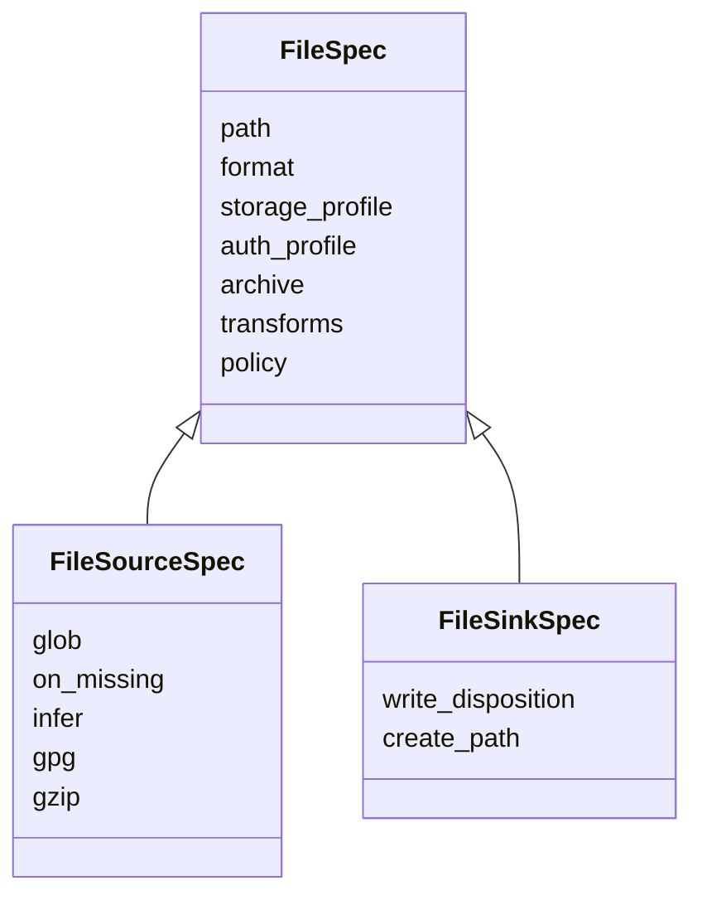
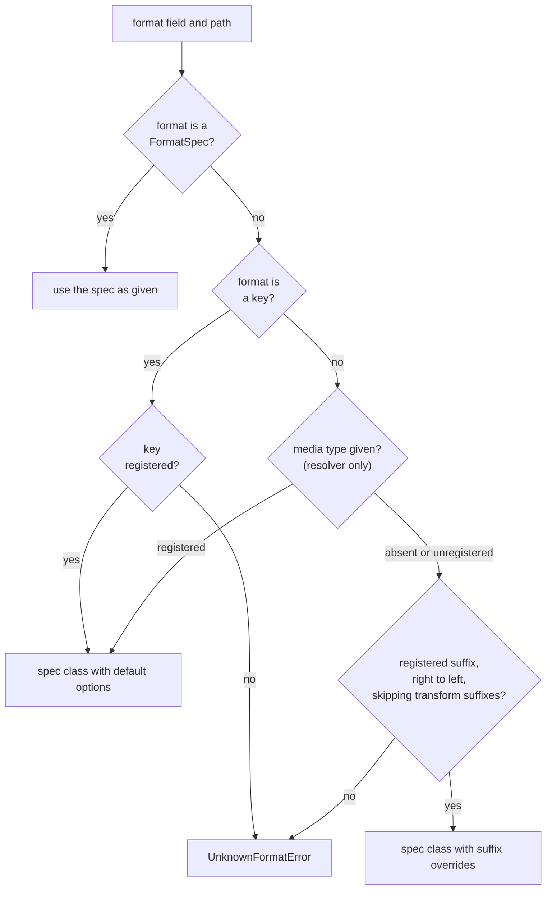

# Files, specs and formats

mountainash-files works with three ideas. A file spec says where a file is and how to reach it. A format key and its format spec say how the file's bytes are interpreted. An operation such as `parse` or `write` takes a file spec, resolves the format and acts on the file. Every other page in this book builds on the definitions here.

## Structured files, Arrow tables and records

<!-- concept:1 -->

A structured file is a file whose bytes follow a format with a known shape. mountainash-files reads six built-in formats. Five of them hold rows and named columns: CSV, TSV, JSON (including newline-delimited JSON), Parquet and Excel. XML holds a tree of elements. Whatever the format, the package handles the file the same way: it resolves which format applies, reads the bytes through storage, hands them to that format's parser, and returns the parsed data together with the format key and the options that were used.

| Format | Shape | What a parse returns | Can be written |
|---|---|---|---|
| CSV, TSV | Delimited rows with a header | Arrow table | Yes |
| JSON, NDJSON | An array of objects, an object, or one object per line | Arrow table | Yes |
| Parquet | Columnar, with a typed schema in its footer | Arrow table | Yes |
| Excel (`.xlsx`, `.xlsm`, `.xlsb`, `.ods`) | Sheets of cells | Arrow table | No (read-only) |
| XML | Element tree | An element, or a list of elements | Yes |

The format decides how the bytes are decoded. The package decides everything around that: how the file is located, how the format is chosen, and what type the caller gets back. That split is why one call shape covers every format:

```python
from mountainash_files import parse_bytes

table = parse_bytes(b"region,total\nnorth,120\nsouth,95\n", "csv").data
print(type(table).__name__, table.schema)
print(table.to_pylist())
```

```text
Table region: string
total: int64
[{'region': 'north', 'total': 120}, {'region': 'south', 'total': 95}]
```

The CSV text became a table with a string column and an integer column. The same call with `"json"` or `"parquet"` and matching bytes returns the same kind of object. [Format options](../format-options/index.md) lists each format's settings, and [What each format supports](../format-options/index.md#what-each-format-supports) gives the per-format matrix of parse, write, schema discovery and append.

<!-- concept:2 -->

### Arrow tables

An Arrow table (`pyarrow.Table`) is an in-memory table of typed columns from the [Apache Arrow](https://arrow.apache.org/docs/python/generated/pyarrow.Table.html) project. It is the default result of every tabular read, and the preferred input to every tabular write.

Arrow columns carry types (`int64`, `double`, `bool`, `date32`, `timestamp[s]`, `string`), so a CSV read and a Parquet read of the same data give equal tables. Polars, pandas and DuckDB all read Arrow tables directly. The CSV, TSV and Parquet writers and Parquet append take an Arrow table as input, so a parsed result can be written in another format as it is (see [Writing and converting](../reading-and-writing/index.md#writing-and-converting)).

In the example above, `table.schema` shows the column types that the CSV parser inferred. `table.num_rows`, `table.column_names` and `table.to_pylist()` are the attributes most examples in this book use.

<!-- concept:3 -->

### Python records

Python records are the alternative to Arrow: a list of dictionaries, one dictionary per row, with column names as keys. Ask for them with `output="pydata"` on `parse` or `parse_bytes`:

```python
from mountainash_files import parse_bytes

records = parse_bytes(b"region,total\nnorth,120\nsouth,95\n", "csv", output="pydata")
print(records.data)
```

```text
[{'region': 'north', 'total': 120}, {'region': 'south', 'total': 95}]
```

The values have the same types as the Arrow columns they came from (here `str` and `int`), because the package parses to Arrow first and converts afterwards. Records suit small results, tests and code that already works with dictionaries. [Arrow or Python records](../reading-and-writing/index.md#arrow-or-python-records) covers when each output is produced and how it behaves for irregular JSON.

<!-- concept:4 -->

### Tabular and non-tabular data

Each format declares whether its data is tabular through the `TABULAR` flag on its format spec class. Tabular formats produce rows and columns, and the package converts their parser output to an Arrow table or to records as the caller asks. Non-tabular formats keep their own payload type, and the `output` setting does not change it.

XML is the one built-in non-tabular format. Its parse returns the root element (or a list of elements when an XPath is set), whether you ask for Arrow or for records:

```python
from mountainash_files import parse_bytes

xml = parse_bytes(b"<sales><row region='north'/></sales>", "xml")
print(type(xml.data).__name__, xml.data.tag)
```

```text
_Element sales
```

The element type is lxml's `_Element` when the `xml` extra is installed, and the standard library's `xml.etree.ElementTree.Element` otherwise. A custom format registers as non-tabular by setting `TABULAR = False` on its spec class ([Registering a format](../custom-formats/index.md#registering-a-format)). Non-tabular formats also have no schema discovery and cannot be appended to. The place where the package converts tabular output is described in [One output seam](../architecture/index.md#one-output-seam).

## Where files live

<!-- concept:5 -->

A file's storage location is the `path` string on its spec. The package does not open files itself. It passes the path, and any profiles attached to the spec, to [mountainash-transport](https://docs.mountainash.io/mountainash-transport/), which picks a storage backend and performs the read or write.

The path takes the forms transport understands:

| Path form | Example | Backend | Extra |
|---|---|---|---|
| Local path, absolute or relative | `/srv/data/sales.csv`, `sales.csv` | Local disk | none |
| HTTP or HTTPS URL | `https://example.com/exports/sales.json` | HTTP (operations depend on the server) | `http` |
| Object store URL | `s3://reports/2026/sales.parquet` | S3 and compatible stores (S3 Express, R2, MinIO, B2) | `s3` |
| SFTP URL | `sftp://host/exports/sales.csv` | SFTP | `sftp` |

With no storage profile on the spec, transport chooses the backend from the path's scheme and uses anonymous access. A storage profile (an object or a profile name) and an auth profile select the backend configuration and credentials explicitly; [Storage and auth profiles](../storage-and-transforms/index.md#storage-and-auth-profiles) covers them. GCS, Azure, FTP, SMB and GitHub profiles exist in transport, but their backends are not implemented yet: a `gs://` path raises transport's `BackendNotImplementedError`.

Because the path is a plain string:

- Creating a spec does nothing. No file is opened, no network call is made and no format is checked until an operation runs.
- Formats are chosen from the path's suffix, so a location's name matters as much as where it is ([How a format is chosen](#how-a-format-is-chosen)).
- A path can contain `{name}` placeholders that an operation fills from its `params` argument, and a source can list many files with a glob ([Selecting files](../selecting-files/index.md)).

By default an operation reads or writes wherever the path points. When paths come from untrusted input, put a `LocationPolicy` on the spec to confine them ([Location policy](../storage-and-transforms/index.md#location-policy)).

<!-- concept:7 -->

### mountainash-transport

mountainash-transport owns every byte of storage access. mountainash-files reaches storage only through the transport package root; its own source contains no direct filesystem, network or SDK calls, and the project's ruff configuration bans them (`pyproject.toml`, `[tool.ruff.lint.flake8-tidy-imports.banned-api]`). The boundary is described for maintainers in [Package invariants](../architecture/index.md#package-invariants).

Transport is responsible for:

- choosing the backend from the path or the storage profile, and authenticating with the auth profile;
- reading, writing, listing (for globs) and streaming bytes;
- compression and encryption transforms such as gzip and GPG, applied as a pipeline around the bytes;
- enforcing a location policy.

mountainash-files is responsible for formats: choosing one, parsing bytes into data, serialising data into bytes, reading schemas, and expanding templates, globs and archives into individual inputs.

Storage errors cross the boundary unchanged. A missing file raises transport's `PathNotFoundError`, with the backend's own error as its `__cause__`:

```python
from mountainash_transport import PathNotFoundError

from mountainash_files import FileSourceSpec, parse

try:
    parse(FileSourceSpec(path="/tmp/no-such-dir/sales.csv"))
except PathNotFoundError as exc:
    print(f"{type(exc).__name__}: {exc}")
```

```text
PathNotFoundError: /tmp/no-such-dir/sales.csv
```

Catch transport's exceptions (`PathNotFoundError`, `AuthenticationError`, `PermissionDeniedError`, `StorageConnectionError`, `StorageError`) for storage failures, and mountainash-files' exceptions for format failures ([Errors and troubleshooting](../errors/index.md)). The [mountainash-transport documentation](https://docs.mountainash.io/mountainash-transport/) describes backends, profiles and transforms in full.

<!-- concept:6 -->

### Optional extras

The core install reads and writes CSV, TSV, JSON, Parquet and XML on local disk. It depends on PyArrow, Polars and mountainash-transport. Other formats and storage backends need optional extras:

| Extra | Adds |
|---|---|
| `xlsx` | fastexcel and openpyxl, for reading Excel workbooks |
| `xml` | lxml (6.1.0 or later); without it, XML parsing uses the standard library |
| `http` | Transport's HTTP stack: URL sources and named storage profiles |
| `s3`, `sftp` | Transport's dependencies for those backends (each includes `http`) |
| `encryption` | Transport's GPG support; GnuPG and keys are also needed |
| `gcs`, `azure` | SDKs for backends that transport has not implemented yet |
| `all` | All of the above |

What happens when an extra is missing depends on who needs it. Reading an Excel file without the `xlsx` extra raises mountainash-files' `MissingDependencyError`, whose message names the extra to install ([Missing optional dependencies](../errors/index.md#missing-optional-dependencies)). XML without `xml` falls back to the standard library parser and raises nothing. Storage backends are loaded by transport, so a missing storage extra surfaces as transport's error: for example, an `s3://` path without the `s3` extra raises `ModuleNotFoundError: No module named 'botocore'`.

## File specs

<!-- concept:8 -->

A file spec (`FileSpec`) is an immutable description of one file location and how to handle it. It is the single argument that says "this file" to an operation. `FileSpec` is the shared base; operations take one of its two subclasses, `FileSourceSpec` for reading and `FileSinkSpec` for writing.

Every file spec has these fields:

| Field | Default | Meaning |
|---|---|---|
| `path` | required | Path or URL. May contain `{name}` placeholders filled from an operation's `params`. |
| `format` | `None` | A format key such as `"csv"`, a format spec instance such as `CsvSpec(delimiter=";")`, or `None` to choose from the path suffix ([The format field](#the-format-field)). |
| `storage_profile` | `None` | A transport storage profile object, a profile name, or `None` to detect the backend from the path scheme. |
| `auth_profile` | `None` | A transport auth profile. An explicit object overrides one resolved from a profile name. |
| `archive` | `None` | `ZipArchive()` or `GzipCompression()` to extract members before parsing ([ZIP archives](../selecting-files/index.md#zip-archives)). Read side only. |
| `transforms` | `None` | An explicit transport `Pipeline`, such as `Pipeline(Gzip())`. |
| `policy` | `None` | A transport `LocationPolicy` confining the spec's locations; `None` means no confinement. |



The split between source and sink keeps read-only settings off writes and write-only settings off reads. Operations check the type they need: `parse`, `inspect_schema` and `stream` take a source, `write` takes a sink, and `copy` takes one of each. The profile, transform and policy fields are passed to transport untouched, apart from a profile name, which is resolved through transport before use ([Storage, profiles and transforms](../storage-and-transforms/index.md)).

<!-- concept:9 -->

### FileSourceSpec

`FileSourceSpec` describes a file, or a set of files, to read. It adds selection and read-side transform settings to the shared fields:

| Field | Default | Meaning |
|---|---|---|
| `glob` | `None` | A pattern relative to `path`; when set, `path` is a base location and every matching file is read ([Globs](../selecting-files/index.md#globs)). |
| `on_missing` | `"raise"` | `"skip"` turns a missing source into an empty result instead of `PathNotFoundError` ([Missing files](../selecting-files/index.md#missing-files)). |
| `infer` | `None` | Whether transport infers decompression and decryption from suffixes such as `.gz` and `.gpg`. `None` keeps each operation's default. |
| `gpg` | `None` | A configured transport `GPG` decoder for inferred `.gpg`, `.pgp` and `.asc` layers. |
| `gzip` | `None` | A configured transport `Gzip` decoder for inferred `.gz` and `.gzip` layers. |

The same source spec works with `parse`, `inspect_schema`, `copy` and `stream`, and its read options apply consistently across them, including to every file a glob selects. [Compression and encryption transforms](../storage-and-transforms/index.md#compression-and-encryption-transforms) explains `infer`, `gpg` and `gzip`.

<!-- concept:10 -->

### FileSinkSpec

`FileSinkSpec` describes where `write`, or the destination side of `copy`, puts data. It adds two fields:

| Field | Default | Meaning |
|---|---|---|
| `write_disposition` | `"replace"` | `"replace"` overwrites the destination; `"append"` adds rows to an existing Parquet file after checking its schema. |
| `create_path` | `True` | Create missing parent directories on storage that has directories (local disk, SFTP). `False` raises `PathNotFoundError` instead. Object stores and HTTP have no directories, so it has no effect there. |

A sink's `transforms` wrap the written bytes, for example `Pipeline(Gzip())` to compress them. Writes do not infer transforms from the suffix: writing to `sales.csv.gz` without a pipeline stores plain CSV under that name. A sink's `archive` field is ignored by `write`, which never creates archives. [Write modes and Parquet append](../write-modes/index.md) covers both dispositions.

```python
import dataclasses

from mountainash_files import FileSinkSpec, FileSourceSpec

source = FileSourceSpec(path="/tmp/reports/sales.csv", on_missing="skip")
sink = FileSinkSpec(path="/tmp/reports/sales.parquet", write_disposition="append")
print(source.format, source.glob, source.on_missing)
print(sink.write_disposition, sink.create_path)

try:
    source.path = "/tmp/reports/other.csv"
except dataclasses.FrozenInstanceError as exc:
    print("FrozenInstanceError:", exc)

monthly = dataclasses.replace(source, path="/tmp/reports/2026-10.csv")
print(monthly.path, monthly.on_missing)
```

```text
None None skip
append True
FrozenInstanceError: cannot assign to field 'path'
/tmp/reports/2026-10.csv skip
```

<!-- concept:12 -->

### Immutable specs

File specs, format specs and the archive specs are frozen dataclasses. Assigning to a field raises `dataclasses.FrozenInstanceError`, as the last example shows. To vary a spec, make a new one with `dataclasses.replace`, which copies every other field.

Immutability means a spec can be built once (at import time, from configuration, or in a shared module) and passed to many operations and threads without any of them changing it for the others. The package relies on this itself: a glob or template never edits the caller's spec, it derives new ones for each matched file. Specs compare by value, so two specs with the same fields are equal, and they are hashable when their field values are.

## Formats and format specs

<!-- concept:13 -->

A format key is the lowercase name the package uses for a format: `csv`, `tsv`, `json`, `parquet`, `xlsx` or `xml` for the built-in ones, plus any key a custom format registers. The key is how everything else refers to a format. Each key maps, in the package's format registry, to:

- a format spec class, which holds the format's options;
- a parser, which turns bytes into data;
- a serialiser, which turns data into bytes (absent for Excel);
- a schema inspector, used by [schema discovery](../schema-discovery/index.md) (absent for XML);
- the path suffixes and media types that identify the format.

Each result records the key that was used, as `ParseResult.format_key` or `SchemaResult.format_key`. You can pass a key anywhere a format is expected: in a spec's `format` field, or as the `format` argument to `parse_bytes`, `serialise_bytes` and `inspect_schema_bytes`. Keys are matched without regard to case, so `"CSV"` also selects CSV.

The built-in keys and the classes behind them:

```python
from mountainash_files.formats.csv import CsvSpec
from mountainash_files.formats.json import JsonSpec
from mountainash_files.formats.parquet import ParquetSpec
from mountainash_files.formats.tsv import TsvSpec
from mountainash_files.formats.xlsx import XlsxSpec
from mountainash_files.formats.xml import XmlSpec

for spec in (CsvSpec, TsvSpec, JsonSpec, ParquetSpec, XlsxSpec, XmlSpec):
    print(f"{spec.FORMAT:8} {spec.__name__:12} tabular={spec.TABULAR!s:5} {' '.join(spec.SUFFIXES)}")
```

```text
csv      CsvSpec      tabular=True  .csv
tsv      TsvSpec      tabular=True  .tsv .tab
json     JsonSpec     tabular=True  .json .ndjson .jsonl .geojson
parquet  ParquetSpec  tabular=True  .parquet .pq
xlsx     XlsxSpec     tabular=True  .xlsx .xlsm .xlsb .ods
xml      XmlSpec      tabular=False .xml
```

There is no `ndjson` key. Newline-delimited JSON is the `json` format with `ndjson=True`, which the `.ndjson` and `.jsonl` suffixes switch on automatically ([JSON and NDJSON](../format-options/index.md#json-and-ndjson)). An unregistered key raises `UnknownFormatError`.

Custom formats get their own keys through `register_format` ([Registering a format](../custom-formats/index.md#registering-a-format)); keys must be lowercase. Installed plugins are discovered when the package is imported, so their keys are available to every operation.

<!-- concept:14 -->

### FormatSpec

A format spec is an instance of a `FormatSpec` subclass: a frozen dataclass whose fields are one format's options and whose class attributes describe the format itself. Each built-in format has one, importable from its public module:

| Spec class | Module |
|---|---|
| `CsvSpec` | `mountainash_files.formats.csv` |
| `TsvSpec` | `mountainash_files.formats.tsv` |
| `JsonSpec` | `mountainash_files.formats.json` |
| `ParquetSpec` | `mountainash_files.formats.parquet` |
| `XlsxSpec` | `mountainash_files.formats.xlsx` |
| `XmlSpec` | `mountainash_files.formats.xml` |

The class attributes are the same on every spec:

| Attribute | Meaning |
|---|---|
| `FORMAT` | The format key. |
| `SUFFIXES` | Path suffixes that select the format. |
| `MEDIATYPES` | Media types registered for the format. |
| `TABULAR` | Whether parse output is converted to Arrow or records (default `True`). |
| `APPENDABLE` | Whether `write_disposition="append"` is allowed (only `ParquetSpec` sets it). |
| `COMPLEX_HANDLER_KEY` | Link to a treespec complex handler for custom formats ([Complex formats and treespec](../custom-formats/index.md#complex-formats-and-treespec)). |

The instance fields are options. Every field has a default, so `CsvSpec()` is a valid spec that reads standard comma-separated files with a header row. Set only what differs:

```python
from mountainash_files import FormatSpec
from mountainash_files.formats.csv import CsvSpec

semicolon = CsvSpec(delimiter=";", null_sequence="NA")
print(isinstance(semicolon, FormatSpec), semicolon.FORMAT, semicolon.SUFFIXES)
print(semicolon.to_options())
print(CsvSpec.from_options({"delimiter": ";", "null_sequence": "NA"}) == semicolon)
```

```text
True csv ('.csv',)
{'delimiter': ';', 'null_sequence': 'NA'}
True
```

`to_options()` returns only the fields that differ from their defaults, as JSON-serialisable values, and `from_options()` rebuilds the spec from such a dictionary. That lets you keep format settings in configuration files ([Format specs as options](../format-options/index.md#format-specs-as-options)). Each format's fields are documented in [Format options](../format-options/index.md).

Results carry the spec that was actually used, as `ParseResult.spec`. When the package builds a spec for you (because you passed a key or nothing), that spec has default options plus any options the matched suffix implies.

<!-- concept:11 -->

### The format field

The `format` field on a file spec, and the `format` argument to the in-memory functions, accept three kinds of value:

- `None` (file specs only): choose the format from the path suffix and build its spec with default options plus any suffix overrides.
- A format key string: use that format with default options. Suffix overrides do not apply, because the suffix was not consulted.
- A format spec instance: use that format with exactly these options. Its `FORMAT` attribute supplies the key.

The difference matters for suffixes that imply options. An `.ndjson` file read with `format=None` gets `ndjson=True` from its suffix; read with `format="json"`, it is parsed as one JSON document and fails:

```python
import tempfile
from pathlib import Path

from mountainash_files import FileSourceSpec, ParseError, parse
from mountainash_files.formats.json import JsonSpec

with tempfile.TemporaryDirectory() as root:
    path = str(Path(root) / "events.ndjson")
    Path(path).write_bytes(b'{"region": "north"}\n{"region": "south"}\n')

    choices = {
        "None": None,
        "JsonSpec(ndjson=True)": JsonSpec(ndjson=True),
        '"json"': "json",
    }
    for label, fmt in choices.items():
        try:
            result, = parse(FileSourceSpec(path=path, format=fmt))
            print(f"{label:22} {result.spec.to_options()}, {result.data.num_rows} rows")
        except ParseError as exc:
            print(f"{label:22} ParseError: {exc}")
```

```text
None                   {'ndjson': True}, 2 rows
JsonSpec(ndjson=True)  {'ndjson': True}, 2 rows
"json"                 ParseError: [json] Extra data: line 2 column 1 (char 20)
```

Pass a spec instance whenever you set options, and a key only when the defaults are what you want.

## How a format is chosen

Before any I/O, every operation that interprets bytes turns the spec's `format` field and path into a format key and a format spec. The rules are fixed and deterministic: the package never looks inside the file to guess its format.

<!-- concept:15 -->

### Suffix detection

When `format` is `None`, the format comes from the path's suffixes. The package reads the suffixes from right to left, skips compression and encryption suffixes, and takes the first suffix that a format has registered. Matching ignores case. If the matched suffix carries options (`.ndjson` and `.jsonl` set `ndjson=True` on `JsonSpec`), the spec is built with them.

```python
import tempfile
from pathlib import Path

import pyarrow as pa
from mountainash_transport import Gzip, Pipeline

from mountainash_files import FileSinkSpec, FileSourceSpec, parse, write

table = pa.table({"region": ["north"], "total": [120]})

with tempfile.TemporaryDirectory() as root:
    for name in ("sales.csv", "SALES.CSV", "sales.2026.pq", "sales.jsonl", "sales.csv.gz"):
        path = str(Path(root) / name)
        transforms = Pipeline(Gzip()) if name.endswith(".gz") else None
        write(FileSinkSpec(path=path, transforms=transforms), table)
        result, = parse(FileSourceSpec(path=path))
        print(f"{name:15} {result.format_key:8} {result.spec.to_options()}")
```

```text
sales.csv       csv      {}
SALES.CSV       csv      {}
sales.2026.pq   parquet  {}
sales.jsonl     json     {'ndjson': True}
sales.csv.gz    csv      {}
```

`sales.2026.pq` shows the right-to-left scan: `.2026` is not a registered suffix, but `.pq` is, and it is the last one. `sales.csv.gz` resolves to CSV because `.gz` is skipped (see [Transform suffixes](#transform-suffixes)); the parse succeeds because transport infers gzip from the same suffix and decompresses the bytes first.

Suffix detection applies to every path the package resolves: a single file, each file a glob selects, and each member of a ZIP archive (by its member name). Archive members and glob results can therefore mix formats.

When no suffix matches, the operation raises `UnknownFormatError` before touching storage. The error lists every registered suffix, and its `path` attribute holds the path that failed. If a format plugin failed to load, the message also names it ([Format errors](../errors/index.md#format-errors)).

<!-- concept:16 -->

### Media type detection

A media type (MIME type) is the other identifier a format can register. `CsvSpec.MEDIATYPES` is `("text/csv",)` and `JsonSpec.MEDIATYPES` is `("application/json", "application/x-ndjson")`. Every built-in format registers at least one; Excel registers only the `.xlsx` workbook type. Registrations are checked for conflicts in the same way as suffixes, and a custom format declares its own in `MEDIATYPES` or through `register_format(..., mediatypes=...)`.

The format registry can resolve a media type to a format key. It ignores parameters (`; charset=utf-8`) and case, and for a structured-syntax type such as `application/geo+json` that has no exact registration it falls back to the base type (`application/json`). This resolver lives in `src/mountainash_files/formats/_registry.py` (`resolve_format`) and is exercised by `tests/test_registry_lazy.py`.

The public operations do not pass a media type to the resolver. File specs have no media type field, and `parse`, `write`, `inspect_schema` and the in-memory functions resolve only from an explicit format or the path suffix. When you hold a media type, for example an HTTP `Content-Type` header, map it to a key yourself from the spec classes' `MEDIATYPES` and pass the key:

```python
from mountainash_files import parse_bytes
from mountainash_files.formats.csv import CsvSpec
from mountainash_files.formats.json import JsonSpec
from mountainash_files.formats.parquet import ParquetSpec
from mountainash_files.formats.tsv import TsvSpec

BY_MEDIATYPE = {
    mediatype: spec.FORMAT
    for spec in (CsvSpec, TsvSpec, JsonSpec, ParquetSpec)
    for mediatype in spec.MEDIATYPES
}


def format_for(content_type: str) -> str:
    return BY_MEDIATYPE[content_type.split(";")[0].strip().lower()]


body = b'[{"region": "north", "total": 120}]'
result = parse_bytes(body, format_for("application/json; charset=utf-8"))
print(result.format_key, result.data.num_rows)
```

```text
json 1
```

<!-- concept:18 -->

### Transform suffixes

Ten suffixes are never treated as format suffixes, because they name a compression or encryption layer rather than a format: `.gz`, `.gzip`, `.bz2`, `.zst`, `.lz4`, `.xz`, `.gpg`, `.pgp`, `.asc` and `.age`. Suffix detection steps over them, so `sales.csv.gz` and `sales.csv.gz.gpg` both resolve to CSV.

Skipping a suffix during format selection does not decompress or decrypt anything. That is transport's job, and transport infers only gzip (`.gz`, `.gzip`) and GPG (`.gpg`, `.pgp`, `.asc`, which also needs a configured `gpg=GPG(...)` on the source). A `.csv.bz2` file resolves to CSV, but its compressed bytes reach the CSV parser unchanged and fail with `ParseError`. Decompress such files before reading, or supply an explicit pipeline ([Compression and encryption transforms](../storage-and-transforms/index.md#compression-and-encryption-transforms)).

<!-- concept:17 -->

### Resolution precedence

When more than one source of format information is present, the most explicit one wins:

1. A format spec instance in `format` is used as is.
2. A format key string in `format` selects that format with default options. An unknown key raises `UnknownFormatError`.
3. A media type, when one is passed to the registry's resolver (no public operation passes one, as described above).
4. The path suffix, read right to left, skipping transform suffixes.
5. Nothing matched: `UnknownFormatError`.



An explicit format always beats the suffix. Here a tab-separated file is misnamed `.csv`; the suffix picks CSV, while a key or a spec overrides it:

```python
import tempfile
from pathlib import Path

from mountainash_files import FileSourceSpec, UnknownFormatError, parse
from mountainash_files.formats.tsv import TsvSpec

with tempfile.TemporaryDirectory() as root:
    path = str(Path(root) / "export.csv")
    Path(path).write_bytes(b"region\ttotal\nnorth\t120\n")

    choices = {
        "suffix": None,
        "key": "tsv",
        "spec": TsvSpec(columns=("total",)),
    }
    for label, fmt in choices.items():
        result, = parse(FileSourceSpec(path=path, format=fmt), output="pydata")
        print(f"{label:6} -> {result.format_key}: {result.data[0]}")

try:
    parse(FileSourceSpec(path="/tmp/no-such-dir/sales.txt"))
except UnknownFormatError as exc:
    print(f"{type(exc).__name__}: {exc}")
```

```text
suffix -> csv: {'region\ttotal': 'north\t120'}
key    -> tsv: {'region': 'north', 'total': 120}
spec   -> tsv: {'total': 120}
UnknownFormatError: Cannot determine format from path='/tmp/no-such-dir/sales.txt'. Known suffixes: .csv, .tsv, .tab, .json, .ndjson, .jsonl, .geojson, .parquet, .pq, .xlsx, .xlsm, .xlsb, .ods, .xml.
```

The last call shows that resolution happens before I/O. The directory does not exist, yet the error is `UnknownFormatError`, not transport's `PathNotFoundError`: an unresolvable format fails fast without a storage round trip. For the same reason `on_missing="skip"` does not suppress it. Two cases resolve later because their names are only known after reading: each file a glob lists, and each archive member.

For a non-explicit format inside a ZIP archive, the member name is resolved first, so `data.zip` containing `north.csv` and `south.json` yields one CSV and one JSON result. A `GzipCompression` archive has no member names, so its format comes from the outer path (`daily.csv.gz` resolves to CSV). The registry and its locking are described for maintainers in [Inside the registry](../architecture/index.md#inside-the-registry).
