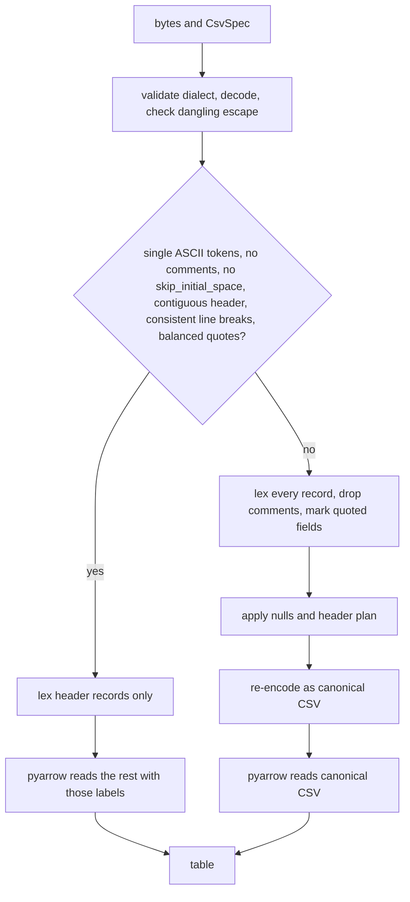
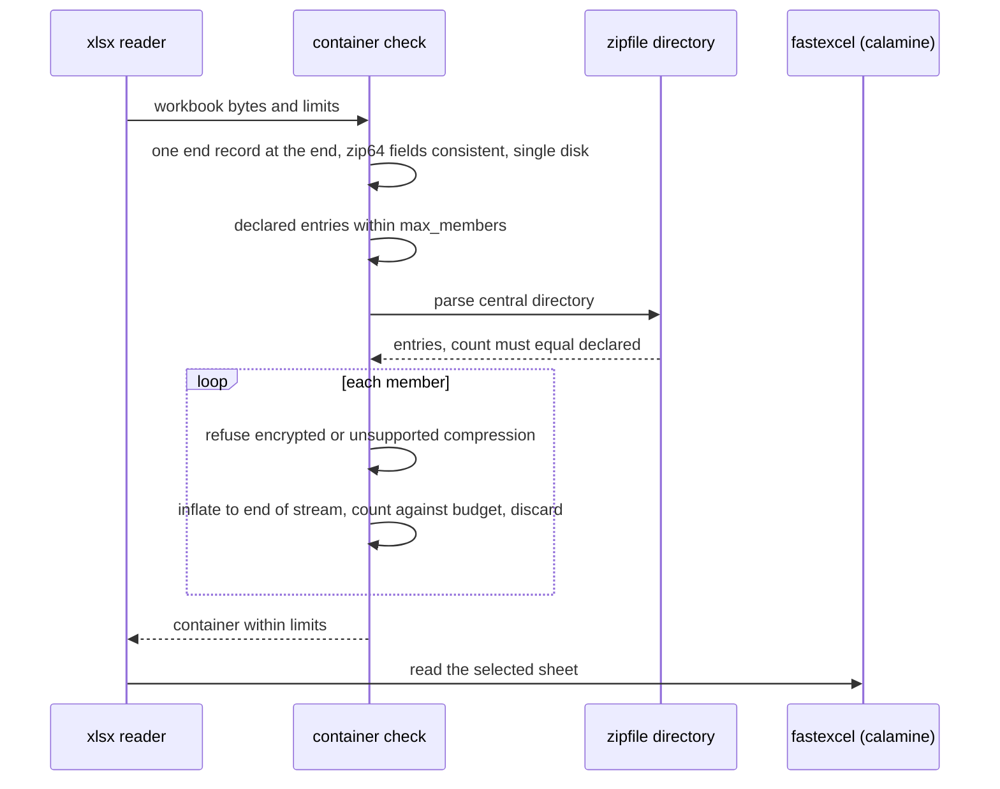

# Format engines and hardening

Each built-in tabular reader wraps a native engine and adds the rules the engine does not provide: standard Arrow types, its own CSV dialect and header handling, comment-aware Excel type inference, schema-checked append, and bounds on zip containers before a third-party reader opens them. The engine for each format is:

| Format | Engine | Code |
|---|---|---|
| CSV, TSV | pyarrow CSV reader, with files' own lexer for dialects it cannot read | `formats/csv.py`, `formats/_delimited.py`, `formats/_rows.py` |
| JSON, NDJSON | polars | `formats/json.py` |
| XLSX | fastexcel (calamine); openpyxl reads header labels | `formats/xlsx.py`, `formats/_xlsx_calamine.py` |
| Parquet | pyarrow `ParquetFile` | `formats/parquet.py` |
| XML | lxml, or the standard library when lxml is not installed | `formats/xml.py` |

Paths are relative to `src/mountainash_files/`. Each code block continues from the one before it. What each format's options do is described in [Format options](../format-options/index.md); the examples here assume it.

## Engine output types

<!-- concept:114 -->

polars and fastexcel produce Arrow data with 64-bit offset types (`large_string`, `large_list`) or view types (`string_view`). Arrow treats these as different types from `string` and `list`, so a JSON table and a CSV table with the same data would otherwise have different schemas, and an append or concatenation between them would fail. `normalise_types` in `formats/_engines.py` converts them, per column, to the standard types:

- `large_string` and `string_view` become `string`; `large_binary` and `binary_view` become `binary`;
- large lists, list views and fixed-size lists become `list`, recursively, and struct and map fields are normalised inside;
- a column keeps its large type when its data cannot fit 32-bit offsets (more than 2^31 - 1 bytes of string data, or list values, in one chunk), so normalisation never fails on very large columns.

The JSON and XLSX readers apply it, then [temporal inference](../format-options/index.md#dates-and-times) on the normalised table. The pyarrow CSV and Parquet readers already return standard types. The same module also provides `native_buffer`, which copies input bytes into Arrow-allocated memory before the CSV and Parquet readers see them, so no Python object backs the buffer the engine reads.

The difference is visible by reading the same NDJSON with polars directly and through files:

```python
import polars as pl

from mountainash_files import parse_bytes
from mountainash_files.formats.json import JsonSpec

payload = b'{"name": "a", "tags": ["x", "y"], "meta": {"k": "v"}}\n'
print(pl.read_ndjson(payload).to_arrow().schema.types)
print(parse_bytes(payload, JsonSpec(ndjson=True)).data.schema.types)
```

```text
[DataType(large_string), LargeListType(large_list<item: large_string>), StructType(struct<k: large_string>)]
[DataType(string), ListType(list<item: string>), StructType(struct<k: string>)]
```

`tests/test_engines.py::test_normalise_types_recurses_and_keeps_values` checks the conversion on nested types.

## CSV internals

<!-- concept:115 -->

### Native path and lexer

`CsvSpec` supports dialects the pyarrow CSV reader cannot read: multi-character delimiters and line terminators, comment rows and comment characters, header rows that are not at the top, and `skip_initial_space`. `csv_parse` in `formats/csv.py` therefore has two paths, and both end in the pyarrow reader, so type inference is the same on either.

Before choosing, it validates the dialect (an ambiguous dialect, such as a delimiter that starts with the line terminator or a quote character equal to the escape character, is a `ParseError`), rejects empty input, decodes with `spec.encoding`, and rejects a dangling final escape. Then it picks a path.

On the native path, taken when every structural character is a single ASCII character, there are no comment rows, comment character or `skip_initial_space`, the header rows are contiguous from row 1, line breaks are consistent with `line_terminator` (for `"\n"`, no carriage return anywhere in the input), and quotes are balanced. mountainash-files reads only the header records with its own lexer to build the labels, then hands the rest of the text to pyarrow as UTF-8 with those labels as column names.

The lexer path handles everything else. The quote-aware lexer in `formats/_delimited.py` splits the whole input into logical records, drops comment records, splits fields while tracking which were quoted, applies the null rules (`null_sequence`, or an unquoted empty field becomes null), applies the header plan in `formats/_rows.py`, and re-encodes the result as canonical CSV (every value quoted, nulls empty and unquoted) for pyarrow to read.



The two paths produce the same table for the same data. A comment line and a `;` delimiter send this input down the lexer path, and the result equals the native-path read of the plain file:

```python
from mountainash_files.formats.csv import CsvSpec

plain = b"id,when,score\n1,2024-03-01,9.5\n2,2024-03-02,\n"
commented = b"# exported 2024-03-03\nid;when;score\n1;2024-03-01;9.5\n2;2024-03-02;\n"

native = parse_bytes(plain, "csv").data
lexed = parse_bytes(commented, CsvSpec(delimiter=";", comment_char="#")).data
print(native.equals(lexed))
print(native.schema)
```

```text
True
id: int64
when: date32[day]
score: double
```

The lexer is a pure-Python character loop, so lexer-path reads of large files are much slower than native ones. A change that widens the native conditions is the main performance lever, and must keep the two paths equal. The lexer has no direct unit tests; `tests/test_csv.py` exercises both paths through `csv_parse`, including `test_non_ascii_delimiter_uses_lexer_path`. With `temporal="text"`, the reader parses once, then reads again with any temporal columns forced to `string`.

<!-- concept:116 -->

### Safe field encoding

The CSV writer guarantees that what it writes reads back as the same fields under the same dialect, or it refuses to write. `encode_record` in `formats/_delimited.py` encodes each record from the last field to the first, so each field knows exactly what text follows it. For each field it tries, in order:

1. quoted, when the dialect has a quote character (embedded quotes are doubled or escaped);
2. raw, only when no delimiter or terminator would start inside the field, and the field holds no line break, quote or escape character (nor a leading space under `skip_initial_space`);
3. escaped, when the dialect has an escape character, escaping every structural character.

A candidate is rejected if it would make the record's first field start with `comment_char`, or would leave a one-field record empty (a blank line, which readers skip). When no candidate is safe, serialisation raises `WriteError`. A null is written as `null_sequence`, or as an empty field when that is unset, and a non-null value equal to `null_sequence` is refused, since it would read back as null.

```python
import pyarrow as pa

from mountainash_files import WriteError, serialise_bytes

table = pa.table({"id": [1, 2, 3], "label": ["a,b", 'say "hi"', "two\nlines"]})
print(serialise_bytes(table, "csv"))

escaped = CsvSpec(quote_char=None, escape_char="\\")
wire = serialise_bytes(table, escaped)
print(wire)
print(parse_bytes(wire, escaped).data.equals(table))

try:
    serialise_bytes(table, CsvSpec(quote_char=None))
except WriteError as exc:
    print(exc)
```

```text
b'"id","label"\n"1","a,b"\n"2","say ""hi"""\n"3","two\nlines"\n'
b'id,label\n1,a\\,b\n2,say "hi"\n3,two\\\nlines\n'
True
Cannot serialise csv: field has no safe representation in this record
```

With a quote character set, the quoted form comes first, so the default dialect quotes every field. One consequence is current behaviour worth knowing: with `null_sequence` unset, a null is written as a quoted empty field, `""`, and a quoted empty field reads back as an empty string rather than null. Set `null_sequence` on both sides when nulls must survive a CSV round trip:

```python
nulls = pa.table({"id": [1, 2], "label": ["x", None]})
print(parse_bytes(serialise_bytes(nulls, "csv"), "csv").data.column("label").to_pylist())

marked = CsvSpec(null_sequence="NA")
print(parse_bytes(serialise_bytes(nulls, marked), marked).data.column("label").to_pylist())
```

```text
['x', '']
['x', None]
```

`tests/test_serialise_formats.py` checks the round-trip guarantee across dialects and the rejection of unrepresentable fields. Formula neutralisation (`formula_neutralise`) runs before encoding and is described in [CSV](../format-options/index.md#csv).

## Excel internals

<!-- concept:119 -->

XLSX reading uses fastexcel, a Python binding to the Rust calamine reader, through `read_calamine` in `formats/_xlsx_calamine.py`. calamine infers a column's type from the cells it loads, so if comment rows and header rows were loaded with the data they would distort the types. The reader keeps them out:

1. It selects the sheet (`sheet_name`, or the one-based `sheet_number`, default the first) and probes its used range. Leading empty columns are restored as null `fieldN` columns, so the table keeps the sheet's column positions.
2. It loads the first used column as text to get true physical row numbers, because calamine's used range omits leading blank rows.
3. It marks comment rows (`comment_rows`, plus rows whose first used cell starts with `comment_char`) and the header rows, counted after comments are removed.
4. It loads each contiguous run of the remaining rows as a separate block, so each block's types come only from data cells. `infer_sample_rows` bounds the rows calamine samples per block.
5. It reads the header labels with openpyxl in read-only mode and joins multi-row headers with `header_join`. Duplicate labels are a `ParseError`.
6. It merges each column's type across blocks: one type is kept; integers and floats together become `double`; anything else becomes `string`, with whole floats written without `.0`.
7. Float columns whose values are all whole numbers within ±2^53 become `int64`, because calamine reports every number as a float.

The result then goes through [type normalisation](#engine-output-types) and temporal inference. A schema inspection with a row budget truncates the blocks at that many data rows.

```python
import io

import openpyxl

from mountainash_files.formats.xlsx import XlsxSpec

workbook = openpyxl.Workbook()
sheet = workbook.active
sheet.append(["site", "count", "reading"])
sheet.append(["A1", 3.0, 1])
sheet.append(["# sensor offline", None, None])
sheet.append(["B2", 4.0, "n/a"])
buffer = io.BytesIO()
workbook.save(buffer)
book = buffer.getvalue()

print(parse_bytes(book, XlsxSpec(comment_char="#")).data.to_pylist())
print(parse_bytes(book, "xlsx").data.to_pylist())
```

```text
[{'site': 'A1', 'count': 3, 'reading': '1'}, {'site': 'B2', 'count': 4, 'reading': 'n/a'}]
[{'site': 'A1', 'count': 3, 'reading': 1}, {'site': '# sensor offline', 'count': None, 'reading': None}, {'site': 'B2', 'count': 4, 'reading': None}]
```

With `comment_char`, the two data rows form two blocks; `reading` is an integer in one and text in the other, so it merges to `string`. Without it, all three rows form one block, calamine types `reading` as numeric, and the text `n/a` becomes null. `count` was stored as floats and comes back as `int64` either way. fastexcel may log a dtype fallback warning on stderr while reading such a sheet.

Before fastexcel sees the bytes, the reader checks the workbook's zip container ([ZIP container hardening](#zip-container-hardening)) and confirms that the `xlsx` extra is installed, raising `MissingDependencyError` otherwise.

## Append merge rules

<!-- concept:118 -->

`write` with `write_disposition="append"` is a read, merge and rewrite of the whole destination, implemented in `write` and `_merge_append_tables` in `src/mountainash_files/_operations.py`. The user-facing rules are in [Appending to Parquet](../write-modes/index.md#appending-to-parquet). The steps are:

1. The format must declare `APPENDABLE` and `TABULAR`; among the built-ins only Parquet does. Raw bytes are refused before format resolution.
2. The incoming data becomes an Arrow table: a table is used as given; a dict or list of dicts becomes a table with keys unioned in first-seen order.
3. The destination is read with suffix inference off and the sink's own `transforms`, so a compressed destination is decoded with the same pipeline that will re-encode it. A missing destination means the incoming table is written as it is.
4. The destination is parsed with the format's parser, with any Parquet column projection removed so the whole table is kept. The parser must return a `pyarrow.Table`, or the append fails with `WriteError`.
5. Column names and types must match in order. There is no reordering, casting or schema evolution; a difference raises `AppendSchemaMismatchError`, which carries both schemas.
6. The merged schema keeps the destination's schema metadata and field metadata. A field is nullable if it is nullable on either side.
7. The two tables are concatenated, serialised and written over the destination.

```python
import tempfile

from mountainash_files import AppendSchemaMismatchError, FileSinkSpec, FileSourceSpec, parse, write
from mountainash_files.formats.parquet import ParquetSpec

schema = pa.schema(
    [pa.field("id", pa.int64(), nullable=False), pa.field("score", pa.float64())],
    metadata={"source": "station-7"},
)
first = pa.table({"id": [1, 2], "score": [9.5, 7.0]}, schema=schema)

with tempfile.TemporaryDirectory() as tmp:
    path = f"{tmp}/scores.parquet"
    write(FileSinkSpec(path), first)
    write(FileSinkSpec(path, write_disposition="append"), [{"id": 3, "score": 4.0}])
    write(
        FileSinkSpec(path, format=ParquetSpec(columns=("id",)), write_disposition="append"),
        pa.table({"id": [4], "score": [5.5]}),
    )
    [result] = parse(FileSourceSpec(path))
    print(result.data.schema)
    print(result.data.column("id").to_pylist())

    try:
        write(FileSinkSpec(path, write_disposition="append"), [{"score": 1.0, "id": 5}])
    except AppendSchemaMismatchError as exc:
        print(exc.expected_schema.names, exc.actual_schema.names)
```

```text
id: int64
score: double
-- schema metadata --
source: 'station-7'
[1, 2, 3, 4]
['id', 'score'] ['score', 'id']
```

`id` was declared non-nullable; record input produces nullable fields, so after the first append `id` is nullable. The `ParquetSpec(columns=("id",))` projection did not narrow the destination. The last call failed because the keys were in a different order.

Record input takes its types from the values. A column that is null in every incoming record has Arrow type `null`, which does not match the destination's type and raises `AppendSchemaMismatchError`; pass a `pyarrow.Table` built with the destination's schema in that case. Each append rewrites the whole object, so its cost grows with the destination, and nothing coordinates concurrent appends to the same path. `tests/test_write.py` covers the rules, including `test_append_ignores_read_projection_and_preserves_schema_metadata` and `test_append_rejects_plugin_parser_without_arrow_table`.

## ZIP container hardening

<!-- concept:117 -->

Zip data reaches mountainash-files in two ways, and both are bounded by the [decompression limits](../selecting-files/index.md#gzip-archives-and-decompression-limits) in `src/mountainash_files/_archives.py`.

For a `ZipArchive` or `GzipCompression` source, files itself extracts the members with the standard `zipfile` and `gzip` modules. A single running budget counts decompressed bytes across all members, read in 64 KiB chunks, and fails as soon as the total passes `max_decompressed_bytes`. `max_members` is checked after `file_pattern` filtering and before any member is read. Each extracted member is held whole in memory, so the budget bounds total memory, not the size of a single read.

An XLSX workbook is also a zip container, but the reader that opens it is calamine's Rust zip implementation, not `zipfile`. Zip readers disagree about malformed containers: one walks the central directory by its declared size, another by its declared entry count; one trusts the zip64 record, another only the classic fields; they search for the end record differently. A crafted file could show `zipfile` a small archive and calamine a large one. `check_zip_container` therefore runs on the raw bytes before fastexcel sees them and refuses anything ambiguous:

- the input must hold exactly one end record, at the end of the data (an archive comment is allowed, other trailing data is not), and no second end record or zip64 record in the directory;
- a zip64 locator must be present exactly when the classic fields hold sentinel values, and every non-sentinel classic field must equal its zip64 value;
- multi-disk archives are refused, and the central directory must end exactly where the end record begins;
- the declared entry count is checked against `XlsxSpec.max_members` before the directory is parsed, and the parsed directory must hold exactly that many entries;
- every member must be stored or deflated and unencrypted, with a valid local header. Each is inflated in chunks until its own compressed stream ends, ignoring the declared sizes so forged sizes cannot hide inflation; the output is counted against `XlsxSpec.max_decompressed_bytes` and discarded, so peak memory stays small.



Input with no end record is not a zip container and is left for fastexcel to reject. Limit failures raise `ArchiveLimitError`, whose message names the setting to raise; a malformed or refused container raises `ParseError` with the `xlsx` key. `ArchiveLimitError` is not exported from the package root (see [Archive errors](../errors/index.md#archive-errors)), so this example catches `Exception`:

```python
from mountainash_files import ParseError

empty = io.BytesIO()
openpyxl.Workbook().save(empty)
book = empty.getvalue()

try:
    parse_bytes(book, XlsxSpec(max_decompressed_bytes=1_000))
except Exception as exc:
    print(type(exc).__name__, exc)

try:
    parse_bytes(book, XlsxSpec(max_members=3))
except Exception as exc:
    print(type(exc).__name__, exc)

try:
    parse_bytes(book + b"trailing bytes", "xlsx")
except ParseError as exc:
    print(exc)
```

```text
ArchiveLimitError zip member 'xl/theme/theme1.xml': decompressed size exceeds max_decompressed_bytes=1000; raise XlsxSpec.max_decompressed_bytes if trusted
ArchiveLimitError zip: 9 members exceeds max_members=3; raise XlsxSpec.max_members if trusted
[xlsx] zip: data after the end record
```

`tests/test_xlsx_limits.py` holds a test for each guard, including forged directory sizes, decoy zip64 records, end records outside `zipfile`'s 64 KiB search window, and bombs rejected with a small memory peak. Each guard closes a specific disagreement between readers; remove one only with a test showing the disagreement cannot occur.
