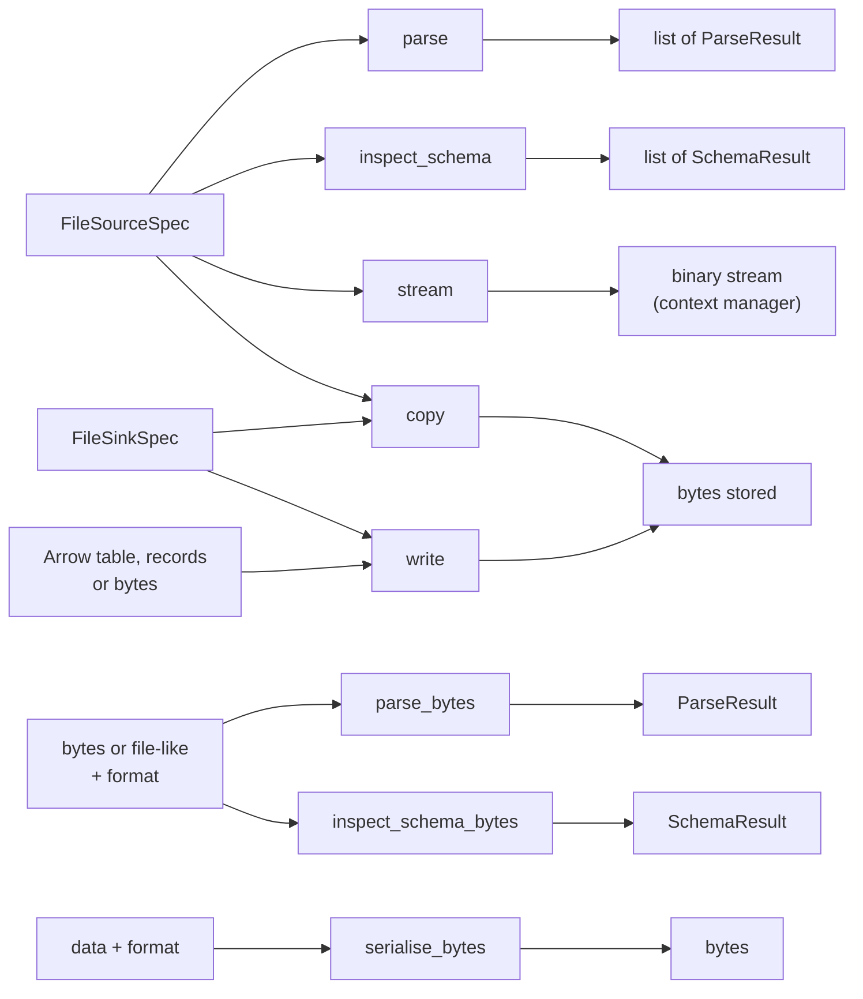

# Reading and writing files

mountainash-files has eight operations, all importable from the package root. `parse` reads files into Arrow tables or Python records, `write` serialises data into a file, and `copy` and `stream` move bytes without parsing them. `parse_bytes` and `serialise_bytes` do the same format work on bytes you already hold. The two schema operations, `inspect_schema` and `inspect_schema_bytes`, are covered in [Schema discovery](../schema-discovery/index.md).



The operations that take a spec resolve the format before any I/O, using the rules in [How a format is chosen](../files-specs-and-formats/index.md#how-a-format-is-chosen), and then read or write through [mountainash-transport](../files-specs-and-formats/index.md#mountainash-transport). All of them accept a `params` dictionary that fills `{name}` placeholders in the spec's path ([Path templates](../selecting-files/index.md#path-templates)).

## Parsing a file

<!-- concept:23 -->

### ParseResult

A `ParseResult` is what a parse produces for one input. It is a frozen dataclass with four fields:

| Field | Meaning |
|---|---|
| `data` | The parsed data: an Arrow table by default, Python records with `output="pydata"`, or a non-tabular format's own payload (an XML element, for example). |
| `format_key` | The format key that was used, such as `"csv"`. |
| `spec` | The format spec instance that was used, including options implied by the suffix. |
| `skipped_members` | Names of ZIP archive members that were skipped as unrecognised; empty otherwise ([ZIP archives](../selecting-files/index.md#zip-archives)). |

`data` is typed as `Any` so that custom formats can return their own payloads. For the built-in tabular formats it is always a `pyarrow.Table` or a list of dictionaries. A result does not record the path it came from: when a source selects several files, results come back in a fixed order (described in [Selecting files](../selecting-files/index.md)), and `format_key` and `spec` tell you how each was read.

<!-- concept:22 -->

### parse

`parse(source, *, params=None, output="arrow")` reads and parses everything a `FileSourceSpec` selects and returns a list of `ParseResult`. The list holds one result per input: one for a plain file, one per file a glob matches, one per archive member, and none for a missing file read with `on_missing="skip"`. It is a list even for a single file, so the usual way to take one result is to unpack it:

```python
import tempfile
from pathlib import Path

from mountainash_files import FileSourceSpec, parse

with tempfile.TemporaryDirectory() as root:
    path = Path(root) / "sales.csv"
    path.write_bytes(b"region,total\nnorth,120\nsouth,95\n")

    results = parse(FileSourceSpec(path=str(path)))
    result = results[0]
    print(len(results), result.format_key, type(result.spec).__name__)
    print(result.data.schema)
    print(result.skipped_members)
```

```text
1 csv CsvSpec
region: string
total: int64
()
```

`result, = parse(...)` is the compact form used across this book; it also raises if the source unexpectedly produced zero or several results.

Each step that can fail raises its own error. An unresolvable format raises `UnknownFormatError` before any storage access. Storage failures raise transport's exceptions, such as `PathNotFoundError`. Content the parser cannot read raises `ParseError`, whose message starts with the format key in brackets. [Errors and troubleshooting](../errors/index.md) lists them all.

`parse` also decides how to fetch the bytes. Most reads fetch the whole object. A Parquet read with a column projection (`ParquetSpec(columns=...)`) instead asks transport for a seekable, ranged handle when no transform applies, so it fetches only the footer and the selected columns from remote storage. [The read pipeline](../architecture/index.md#the-read-pipeline) describes that routing, and [Parquet](../format-options/index.md#parquet) its column projection.

## Arrow or Python records

<!-- concept:24 -->

The `output` argument on `parse` and `parse_bytes` chooses the type of `ParseResult.data` for tabular formats. `"arrow"` (the default) returns a `pyarrow.Table`; `"pydata"` returns a list of dictionaries. Any other value raises `ValueError` before anything is read.

Every built-in tabular parser produces an Arrow table, so `"pydata"` is that table converted with `to_pylist()`. Each record therefore has every column, with `None` where a value is missing. That matters for JSON whose objects have different keys:

```python
from mountainash_files import ParseError, parse_bytes

ragged = b'[{"region": "north", "total": 120}, {"region": "south", "note": "late"}]'
print(parse_bytes(ragged, "json").data.column_names)
print(parse_bytes(ragged, "json", output="pydata").data)

scalars = b"[120, 95]"
print(parse_bytes(scalars, "json", output="pydata").data)
try:
    parse_bytes(scalars, "json")
except ParseError as exc:
    print(f"ParseError: {exc}")

xml = parse_bytes(b"<sales><row region='north'/></sales>", "xml", output="pydata")
print(xml.data.tag, [row.get("region") for row in xml.data])
```

```text
['region', 'total', 'note']
[{'region': 'north', 'total': 120, 'note': None}, {'region': 'south', 'total': None, 'note': 'late'}]
[120, 95]
ParseError: [json] non-record JSON array is not tabular; expected an array of objects
sales ['north']
```

The columns are the union of keys in first-seen order. A JSON array of scalars has no columns: `"pydata"` returns the list as it is, and `"arrow"` raises `ParseError`. Non-tabular formats such as XML ignore `output` and return their own payload ([Tabular and non-tabular data](../files-specs-and-formats/index.md#tabular-and-non-tabular-data)).

Choose Arrow for anything you will analyse, convert or write again, since it keeps column types and goes straight to Polars, pandas, DuckDB or a writer. Choose records for small results, assertions in tests and code that already expects dictionaries. The conversion happens in one place for every format, described in [One output seam](../architecture/index.md#one-output-seam).

## Writing and converting

<!-- concept:26 -->

### write

`write(sink, data, *, params=None)` serialises `data` in the sink's format and stores the bytes through transport. It returns `None`. The format comes from the sink exactly as for a read: an explicit `format`, or the path suffix.

What `data` can be depends on the format, because `write` hands it to the format's serialiser unchanged:

| Format | Accepted `data` |
|---|---|
| CSV, TSV, Parquet | A `pyarrow.Table`. Python records raise `AttributeError`; convert them first with `pyarrow.Table.from_pylist(records)`. |
| JSON | A `pyarrow.Table`, a list of records or a single dictionary. A list becomes one line per item when the spec has `ndjson=True` (the `.ndjson` and `.jsonl` suffixes set it). |
| XML | An lxml or ElementTree element. |
| Excel | None: Excel is read-only, and `write` raises `WriteError`. |
| Any path | `bytes`, which are written as they are, with no format handling. |

```python
import tempfile
from pathlib import Path

import pyarrow as pa

from mountainash_files import FileSinkSpec, WriteError, write

sales = pa.table({"region": ["north", "south"], "total": [120, 95]})

with tempfile.TemporaryDirectory() as root:
    out = Path(root) / "2026" / "sales.csv"
    write(FileSinkSpec(path=str(out)), sales)
    print(out.read_bytes())

    write(FileSinkSpec(path=str(Path(root) / "sales.json")), sales.to_pylist())
    print((Path(root) / "sales.json").read_bytes())

    raw = Path(root) / "notes.txt"
    write(FileSinkSpec(path=str(raw)), b"written as-is\n")
    print(raw.read_bytes())

    try:
        write(FileSinkSpec(path=str(Path(root) / "sales.xlsx")), sales)
    except WriteError as exc:
        print(f"WriteError: {exc}")
```

```text
b'"region","total"\n"north","120"\n"south","95"\n'
b'[{"region": "north", "total": 120}, {"region": "south", "total": 95}]'
b'written as-is\n'
WriteError: No serialiser registered for format 'xlsx'
```

Points the example shows:

- The `2026` directory did not exist. `create_path=True`, the default, creates missing parent directories on storage that has them.
- `notes.txt` has no registered suffix, yet the write succeeds: raw `bytes` skip format resolution entirely. Only `bytes` objects take this path; a `bytearray` goes through the format's serialiser.
- The CSV writer quotes every field. CSV writer options are listed under [CSV](../format-options/index.md#csv).

The default disposition, `"replace"`, overwrites the destination. Appending to a Parquet file with `write_disposition="append"` is covered in [Write modes and Parquet append](../write-modes/index.md).

`write` does not infer compression from the suffix. Writing to `sales.csv.gz` without a pipeline stores plain CSV under that name, which a later `parse` then fails to decompress. Set `transforms=Pipeline(Gzip())` on the sink to compress ([Compression and encryption transforms](../storage-and-transforms/index.md#compression-and-encryption-transforms)).

<!-- concept:87 -->

### Converting between formats

To convert a file, parse it and write the result to a path (or spec) in the target format. The Arrow table in between carries the column types, so the data survives the round trip:

```python
import tempfile
from pathlib import Path

from mountainash_files import FileSinkSpec, FileSourceSpec, parse, write

with tempfile.TemporaryDirectory() as root:
    source = Path(root) / "sales.csv"
    source.write_bytes(b"region,total\nnorth,120\nsouth,95\n")

    original, = parse(FileSourceSpec(path=str(source)))
    for suffix in ("parquet", "ndjson"):
        destination = str(Path(root) / f"sales.{suffix}")
        write(FileSinkSpec(path=destination), original.data)
        converted, = parse(FileSourceSpec(path=destination))
        same = converted.data.to_pylist() == original.data.to_pylist()
        print(f"csv -> {suffix}: {converted.data.num_rows} rows, equal={same}")
```

```text
csv -> parquet: 2 rows, equal=True
csv -> ndjson: 2 rows, equal=True
```

Keep the default `output="arrow"` when converting, since the CSV, TSV and Parquet writers take an Arrow table. `copy` does not convert: it moves bytes unchanged. Equal values do not guarantee equal Arrow types in every direction, because text formats infer types on read; [Format options](../format-options/index.md) describes the type inference of each format and how to control it.

## Buffers you already hold

`parse_bytes` and `serialise_bytes` apply a format to data in memory: HTTP response bodies, message payloads, test fixtures. They take an explicit format (a key or a format spec instance), because there is no path to read a suffix from. They do not touch storage, and they never apply transforms, so compressed or encrypted bytes must be decoded first.

<!-- concept:25 -->

### parse_bytes

`parse_bytes(data, format, *, output="arrow")` parses `bytes` or a binary file-like object and returns a single `ParseResult`. A file-like object is read in full but not closed; it stays the caller's to close. The `output` argument behaves as in `parse`.

<!-- concept:27 -->

### serialise_bytes

`serialise_bytes(data, format)` is the inverse: it serialises data with a format's serialiser and returns the bytes. Accepted data follows the table under [write](#write). A format without a serialiser (Excel) raises `WriteError`.

```python
import io

from mountainash_files import parse_bytes, serialise_bytes
from mountainash_files.formats.json import JsonSpec

body = io.BytesIO(b"region,total\nnorth,120\nsouth,95\n")
result = parse_bytes(body, "csv")
print(result.format_key, result.data.num_rows, body.closed)

ndjson = JsonSpec(ndjson=True)
encoded = serialise_bytes(result.data, ndjson)
print(encoded.decode(), end="")

decoded = parse_bytes(encoded, ndjson, output="pydata")
print(decoded.data)
```

```text
csv 2 False
{"region": "north", "total": 120}
{"region": "south", "total": 95}
[{'region': 'north', 'total': 120}, {'region': 'south', 'total': 95}]
```

NDJSON needs `JsonSpec(ndjson=True)` here: the `.ndjson` suffix is what normally switches it on, and in-memory calls have no suffix. To read only the schema of a buffer, use `inspect_schema_bytes` ([In-memory buffers](../schema-discovery/index.md#in-memory-buffers)).

## Copying bytes and opening streams

`copy` and `stream` work below the format layer: they move bytes and never parse them, so they need no format and work with any file, including ones with unregistered suffixes. Source transforms still apply, so both see decompressed, decrypted bytes.

<!-- concept:28 -->

### copy

`copy(source, sink, *, params=None)` reads the bytes a `FileSourceSpec` names and writes them to a `FileSinkSpec`. The source's transforms unwrap (decompress or decrypt, inferred from suffixes by default), and the sink's transforms wrap (compress or encrypt). Source and destination can be on different storage, each with its own profiles and location policy. `params` fills placeholders in both paths.

`copy` reads one file into memory and writes it in one call. It does not expand globs or extract archives (it reads the source path as given), does not convert formats, and does not append; it always replaces the destination. With `on_missing="skip"` on the source, a missing source makes `copy` do nothing.

<!-- concept:29 -->

### stream

`stream(source, *, params=None, access="sequential", range_policy=None)` is a context manager that yields a binary file-like object over the source's bytes, after transforms, without parsing. The stream is closed when the `with` block exits, normally or by an exception, so read inside the block.

```python
import tempfile
from pathlib import Path

from mountainash_transport import Gzip, Pipeline

from mountainash_files import FileSinkSpec, FileSourceSpec, copy, stream, write

SALES = b"region,total\nnorth,120\nsouth,95\n"

with tempfile.TemporaryDirectory() as root:
    packed = str(Path(root) / "sales.csv.gz")
    plain = str(Path(root) / "sales-copy.csv")
    write(FileSinkSpec(path=packed, transforms=Pipeline(Gzip())), SALES)
    print(Path(packed).read_bytes()[:2])

    copy(FileSourceSpec(path=packed), FileSinkSpec(path=plain))
    print(Path(plain).read_bytes() == SALES)

    with stream(FileSourceSpec(path=packed)) as reader:
        print(reader.readline())
        print(reader.read())
    print(reader.closed)
```

```text
b'\x1f\x8b'
True
b'region,total\n'
b'north,120\nsouth,95\n'
True
```

The stored file starts with the gzip magic bytes `1f 8b`; `copy` and `stream` both inferred gzip from `.gz` and returned the plain CSV.

`stream` hands the stream over from transport without reading it first, so errors from decoding or the network can surface during reads as well as when the stream opens. `on_missing="skip"` yields an empty stream for a missing source; it covers only the opening, not later reads. Whether the stream can seek depends on the backend and the transforms: check `seekable()` before seeking, and note that offsets count decoded bytes.

`access` (`"sequential"`, `"random"` or `"buffered"`) and `range_policy` go to transport unchanged, and there is no fallback: if transport refuses a combination, such as random access through a transform or on a server without byte ranges, its error propagates. [Stream access](../storage-and-transforms/index.md#stream-access) explains the modes. `parse` and `inspect_schema` choose their access mode themselves and do fall back to whole-object reads.
