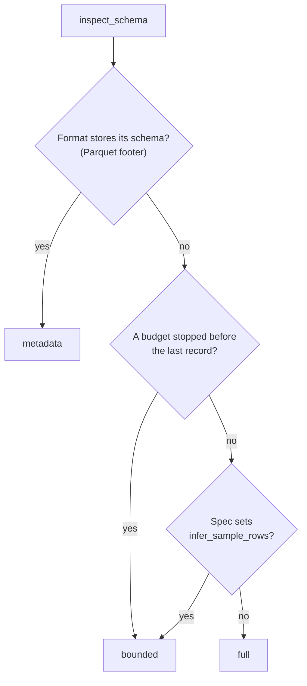

# Schema discovery

Schema discovery reports the Arrow schema of a file (column names and types) without returning its rows. `inspect_schema()` selects inputs exactly as `parse()` does and returns one result per input. `inspect_schema_bytes()` does the same for a buffer you already hold. Each result records how the schema was obtained: from format metadata, from every record, or from a bounded prefix.

Use it to check an incoming file against an expected layout, to plan a load, or to look at a large remote file cheaply. A Parquet schema comes from the file footer alone, and a bounded CSV or NDJSON discovery reads only a prefix of the file.

## Inspecting a schema

<!-- concept:77 -->

`SchemaResult` is the result type, an immutable dataclass with five fields:

| Field | Meaning |
|---|---|
| `schema` | The observed `pyarrow.Schema` |
| `basis` | `"metadata"`, `"full"` or `"bounded"`: how the schema was obtained (see [How a schema was obtained](#how-a-schema-was-obtained)) |
| `format_key` | The resolved format key, such as `"csv"` |
| `spec` | The `FormatSpec` instance used, including options from the source or suffix |
| `skipped_members` | Names of ZIP members skipped with `on_unrecognised="skip"`; empty otherwise |

It mirrors `ParseResult`, with `schema` and `basis` in place of `data`. A result is an observation, not a contract. Discovery does not change later parses, and a file that changes afterwards can parse differently.

<!-- concept:76 -->

`inspect_schema(source, *, params=None, infer_schema_rows=None)` takes the same `FileSourceSpec` as [`parse()`](../reading-and-writing/index.md#parsing-a-file). Path templates, globs, ZIP and gzip archives, transforms, storage profiles, location policy and `on_missing` all behave as they do for parsing, and the return value is always a list, with one `SchemaResult` per selected file or archive member:

```python
import tempfile

import pyarrow as pa
from mountainash_files import FileSinkSpec, FileSourceSpec, inspect_schema, write

with tempfile.TemporaryDirectory() as root:
    for month, totals in (("01", [120, 95]), ("02", [130, 88])):
        write(
            FileSinkSpec(path=f"{root}/sales-{month}.csv"),
            pa.table({"region": ["north", "south"], "total": totals}),
        )
    results = inspect_schema(FileSourceSpec(path=root, glob="*.csv"))
    for result in results:
        print(result.format_key, result.basis, result.schema.names, result.schema.types)
    print(type(results[0].spec).__name__, results[0].skipped_members)
```

```text
csv full ['region', 'total'] [DataType(string), DataType(int64)]
csv full ['region', 'total'] [DataType(string), DataType(int64)]
CsvSpec ()
```

Each built-in format runs its own parse engine over the inspected records and keeps only the schema. A `full` result therefore has the types `parse()` produces for the same input and spec, including the [format options](../format-options/index.md#format-specs-as-options) and [temporal inference](../format-options/index.md#dates-and-times) that apply.

Discovery works for CSV, TSV, JSON, NDJSON, Parquet and Excel. XML and plugin formats registered without a schema inspector raise `SchemaDiscoveryUnsupportedError`. The check runs before the file is read, even with `on_missing="skip"`; archive members are checked after the archive is read. See [Format errors](../errors/index.md#format-errors). Excel discovery needs the `[xlsx]` extra, like Excel parsing. Malformed content raises `ParseError`, as it does when parsing.

## How a schema was obtained

<!-- concept:78 -->

`SchemaResult.basis` records what the schema rests on:

| Basis | Meaning |
|---|---|
| `metadata` | Read from format metadata (the Parquet footer). No records were inspected. |
| `full` | Every record was inspected. |
| `bounded` | Not every record was inspected. Columns or types that first appear later can be missing. |



`JsonSpec` and `XlsxSpec` have an `infer_sample_rows` option that limits the rows the parse engine uses for type inference. Because that applies to parsing as well, a schema found with it set is `bounded` even when every record was read:

```python
from mountainash_files import inspect_schema_bytes
from mountainash_files.formats.json import JsonSpec

data = b'{"id": 1}\n{"id": 2, "note": "late"}\n'
print(inspect_schema_bytes(data, JsonSpec(ndjson=True)).schema.names)
print(inspect_schema_bytes(data, JsonSpec(ndjson=True), infer_schema_rows=1).schema.names)
sampled = inspect_schema_bytes(data, JsonSpec(ndjson=True, infer_sample_rows=1))
print(sampled.basis, sampled.schema.names)
```

```text
['id', 'note']
['id']
bounded ['id']
```

<!-- concept:79 -->

### The infer_schema_rows budget

`infer_schema_rows` sets the data budget for each selected input. `None`, the default, inspects every record. A positive integer N bounds discovery to the first N data records. Header rows and comment rows do not count, and if a CSV header row comes after the Nth data record, the records before it are read and also contribute. Any other value raises `ValueError` before any I/O:

```python
from mountainash_files import inspect_schema_bytes

data = b"id,code\n1,10\n2,20\n3,N/A\n"

for budget in (None, 2, 5):
    result = inspect_schema_bytes(data, "csv", infer_schema_rows=budget)
    print(budget, result.basis, result.schema.field("code").type)
```

```text
None full string
2 bounded int64
5 full string
```

With a budget of 2, the `N/A` in the third record is never seen, so `code` looks like `int64`. A budget that reaches the end of the input gives `full`.

The budget is the only cost control, and what it saves depends on the format:

| Format | Full budget | Finite budget |
|---|---|---|
| Parquet | Footer only | Same as full: footer only |
| CSV, TSV, NDJSON | Whole object, about one parse | Only a prefix is read, then the stream is closed, so cost follows the budget rather than the file size |
| JSON document | Whole object, about one parse | Still decodes the whole document |
| Excel | Whole workbook, about one parse | Still decodes the whole sheet |

Prefix reads need direct stream access. With transforms or archives, the whole object is decoded first and the budget then limits inference only. UTF-16 and UTF-32 NDJSON is also read whole. In archives, the budget applies to each member separately.

```python
from mountainash_files import FileSourceSpec, inspect_schema

try:
    inspect_schema(FileSourceSpec(path="sales.csv"), infer_schema_rows=0)
except ValueError as exc:
    print(exc)
```

```text
infer_schema_rows must be a positive int or None, got 0
```

## Parquet footers

<!-- concept:81 -->

Parquet files store their schema in a footer at the end of the file. Discovery reads that footer and never reads data pages, so its basis is always `metadata` and `infer_schema_rows` makes no difference. The footer schema follows parse's projection rules: with `ParquetSpec(columns=[...])` the result holds only those columns, and a dotted nested name gives the leaf field.

Because data pages are never read, discovery succeeds on a file whose data is damaged, while parsing it fails:

```python
import io

import pyarrow as pa
import pyarrow.parquet as pq
from mountainash_files import ParseError, inspect_schema_bytes, parse_bytes, serialise_bytes
from mountainash_files.formats.parquet import ParquetSpec

table = pa.table({"region": ["north", "south"] * 500, "total": list(range(1000))})
raw = bytearray(serialise_bytes(table, "parquet"))

# Overwrite the start of the first data page; the footer stays intact.
page = pq.ParquetFile(io.BytesIO(bytes(raw))).metadata.row_group(0).column(0).data_page_offset
raw[page:page + 64] = b"\xff" * 64

result = inspect_schema_bytes(bytes(raw), ParquetSpec(columns=["total"]))
print(result.basis, result.schema)
try:
    parse_bytes(bytes(raw), "parquet")
except ParseError as exc:
    print("parse failed:", type(exc).__name__)
```

```text
metadata total: int64
parse failed: ParseError
```

On remote storage, `inspect_schema()` asks transport for a seekable ranged handle and fetches only the footer. Over HTTP, the test suite checks that no plain GET is made and that less than half the file is transferred (`test_http_parquet_fetches_the_footer_only` in `tests/test_schema_sources.py`). When transforms apply, as with `sales.parquet.gz`, or the server does not support byte ranges, the whole object is fetched and the footer is read from those bytes. See [Stream access](../storage-and-transforms/index.md#stream-access).

## In-memory buffers

<!-- concept:80 -->

`inspect_schema_bytes(data, format, *, infer_schema_rows=None)` inspects bytes or a binary file-like object you already hold, such as an HTTP response body or a message payload. It is the discovery counterpart of [`parse_bytes()`](../reading-and-writing/index.md#buffers-you-already-hold). The format is required, as a key or a `FormatSpec` instance, because there is no path to infer it from. It returns one `SchemaResult`, not a list, and applies no transforms.

A stream you pass in is borrowed: discovery reads from it but does not close it, on success or failure.

```python
import io

from mountainash_files import inspect_schema_bytes

buffer = io.BytesIO(b"region,total\nnorth,120\nsouth,95\n")
result = inspect_schema_bytes(buffer, "csv")
print(result.basis, result.schema.names)
print(buffer.closed, buffer.tell())
```

```text
full ['region', 'total']
False 32
```

With a finite budget on CSV or NDJSON, the stream is read in chunks only until the budget is met, so a large stream is left part-way through. The budget is validated before the stream is touched.
