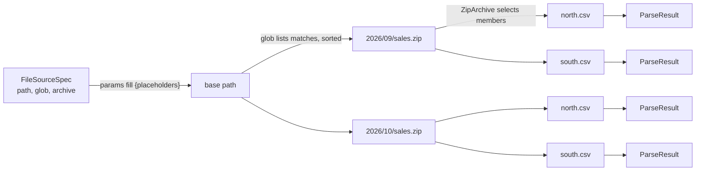

# Selecting files

A single `FileSourceSpec` can stand for many inputs. A path template fills placeholders from the call's `params`, a glob lists every matching file under a base location, and an archive setting opens a ZIP or gzip file and hands each member to its parser. `on_missing` decides whether an absent file is an error. Selection happens before parsing and works the same on local disk and remote storage, and `parse` and `inspect_schema` return one result per selected input.



The steps nest in a fixed order: template, then glob, then archive, then format resolution for each input. All four can apply to one spec:

```python
import tempfile
import zipfile
from pathlib import Path

from mountainash_files import FileSourceSpec, ZipArchive, parse

with tempfile.TemporaryDirectory() as root:
    for month, scale in (("09", 1), ("10", 2)):
        folder = Path(root) / "2026" / month
        folder.mkdir(parents=True)
        with zipfile.ZipFile(folder / "sales.zip", "w") as archive:
            archive.writestr("north.csv", f"region,total\nnorth,{120 * scale}\n")
            archive.writestr("south.csv", f"region,total\nsouth,{95 * scale}\n")
            archive.writestr("notes.txt", "Monthly sales.")

    source = FileSourceSpec(
        path=f"{root}/{{year}}",
        glob="*/sales.zip",
        archive=ZipArchive(file_pattern="*.csv"),
    )
    results = parse(source, params={"year": 2026}, output="pydata")
    print(len(results), [result.data[0]["total"] for result in results])
```

```text
4 [120, 95, 240, 190]
```

Results come back in a deterministic order: matched paths sorted, then each archive's members in name order. A `ParseResult` does not record which file or member it came from. When you need the origin of each result, list the files first and call `parse` once per path, or keep one member per archive.

## Path templates

<!-- concept:30 -->

A path template is a spec path containing `{name}` placeholders. `parse`, `inspect_schema`, `write`, `copy` and `stream` fill them from their `params` argument using Python's `str.format`, so the same spec can name a different file on each call:

```python
import tempfile
from pathlib import Path

import pyarrow as pa

from mountainash_files import FileSinkSpec, FileSourceSpec, parse, write

with tempfile.TemporaryDirectory() as root:
    sink = FileSinkSpec(path=f"{root}/{{year}}/{{region}}.csv")
    source = FileSourceSpec(path=f"{root}/{{year}}/{{region}}.csv")

    for region, total in (("north", 120), ("south", 95)):
        params = {"year": 2026, "region": region}
        write(sink, pa.table({"region": [region], "total": [total]}), params=params)

    result, = parse(source, params={"year": 2026, "region": "south"}, output="pydata")
    print(result.data)
    print(sorted(p.relative_to(root).as_posix() for p in Path(root).rglob("*.csv")))
```

```text
[{'region': 'south', 'total': 95}]
['2026/north.csv', '2026/south.csv']
```

The rules follow from `str.format`:

- Only the `path` is formatted. A glob pattern and a ZIP `file_pattern` are used as written.
- Without `params` (or with an empty dictionary) the path is used literally, braces included.
- A placeholder with no matching key raises `KeyError` before any I/O.
- Format specifications work as in `str.format`, for example `{day:02d}`. Write a literal brace as `{{` or `}}`.
- `copy` fills both the source and the sink path from the same `params`.

Templates build paths from values, so treat `params` from untrusted input like any other untrusted path: a value such as `../other` changes the directory. Put a `LocationPolicy` on the spec to confine where the filled path can point ([Location policy](../storage-and-transforms/index.md#location-policy)).

## Globs

<!-- concept:31 -->

Setting `glob` on a source turns its `path` into a base location and selects every file beneath it whose path, relative to that base, matches the pattern. Each matching file becomes its own input, read with the rest of the spec's settings (format, archive, transforms, profiles, policy), and the results are concatenated in sorted path order.

Listing goes through transport's `list_objects`, so globs work wherever transport can enumerate: local disk, SFTP and the S3 family. The base path is listed with the spec's storage profile, auth profile and location policy. Each matched file then resolves its own format from its suffix, unless the spec sets `format`.

```python
import tempfile
from pathlib import Path

from mountainash_files import FileSourceSpec, UnknownFormatError, parse

with tempfile.TemporaryDirectory() as root:
    for name in ("north.csv", "south.csv", "2026/east.csv", "2026/q4/west.csv", "notes.txt"):
        path = Path(root) / name
        path.parent.mkdir(parents=True, exist_ok=True)
        path.write_bytes(f"region,total\n{path.stem},1\n".encode())

    for pattern in ("*.csv", "**/*.csv", "2026/*.csv", "[ns]*.csv", "**"):
        try:
            results = parse(FileSourceSpec(path=root, glob=pattern), output="pydata")
        except UnknownFormatError as exc:
            print(f"{pattern:10} UnknownFormatError for {Path(exc.path).name}")
            continue
        print(f"{pattern:10} {[row['region'] for r in results for row in r.data]}")

    print(parse(FileSourceSpec(path=f"{root}/missing", glob="*.csv")))
```

```text
*.csv      ['north', 'south']
**/*.csv   ['east', 'west', 'north', 'south']
2026/*.csv ['east']
[ns]*.csv  ['north', 'south']
**         UnknownFormatError for notes.txt
[]
```

`**` alone matched `notes.txt`, which has no registered suffix, so the whole parse failed. Narrow the pattern to the files you want, or set `format` on the spec to read every match with one format.

A base location that does not exist, or a pattern that matches nothing, returns an empty list rather than raising. A base that is a file rather than a directory raises transport's `StorageError`.

<!-- concept:32 -->

### Matching rules

Patterns match path segments, the parts between `/` separators, and the rules are the same on every backend:

| Pattern | Matches |
|---|---|
| `*` | Any run of characters within one segment, including none. |
| `?` | Exactly one character within one segment. |
| `[abc]`, `[a-z]`, `[!a]` | One character from (or not from) a set, within one segment. |
| `**` as a whole segment | Zero or more whole segments. |

So `*.csv` matches files directly under the base only, `**/*.csv` matches CSV files at any depth (including directly under the base, since `**` can match zero segments), and `2026/*.csv` matches only inside `2026`. The order of results is the sorted order of the full paths, which is why `2026/east.csv` comes before `north.csv` in the example.

Matching is case-sensitive on every backend, and `*` also matches names that begin with a dot, unlike a shell glob. A pattern segment of `.` or an empty segment (from `//`) is ignored. Object stores sometimes hold empty-named "directory marker" keys; they are never returned as files. Earlier releases matched only the final name on object stores, so `*.csv` also selected nested objects there; use `**/*.csv` for that now.

## Missing files

<!-- concept:33 -->

`on_missing` on a `FileSourceSpec` decides what happens when the source does not exist. The default, `"raise"`, lets transport's `PathNotFoundError` propagate. `"skip"` treats a missing source as empty, in the way that fits each operation:

| Operation | Missing source with `on_missing="skip"` |
|---|---|
| `parse`, `inspect_schema` | Return `[]` |
| `copy` | Do nothing; the destination is not created |
| `stream` | Yield an empty stream |

```python
import tempfile
from pathlib import Path

from mountainash_files import (
    FileSinkSpec, FileSourceSpec, UnknownFormatError, copy, inspect_schema, parse, stream,
)

with tempfile.TemporaryDirectory() as root:
    absent = FileSourceSpec(path=f"{root}/west.csv", on_missing="skip")

    print(parse(absent), inspect_schema(absent))
    copy(absent, FileSinkSpec(path=f"{root}/west-copy.csv"))
    print(Path(f"{root}/west-copy.csv").exists())
    with stream(absent) as reader:
        print(reader.read())

    try:
        parse(FileSourceSpec(path=f"{root}/west.dat", on_missing="skip"))
    except UnknownFormatError as exc:
        print("UnknownFormatError:", Path(exc.path).name)
```

```text
[] []
False
b''
UnknownFormatError: west.dat
```

Only a missing file is skipped. Permission, connection, format and parse errors still raise, and so does an unresolvable format, because the format is resolved before the file is looked for (the last call). `on_missing="skip"` also does not hide a missing schema inspector: [Schema discovery](../schema-discovery/index.md) raises for XML before reading anything.

With a glob, `on_missing` is not needed for an absent base: a glob that finds nothing already returns `[]`. A template with `on_missing="skip"` suits optional inputs, such as a report that exists only for some regions.

## ZIP archives

<!-- concept:34 -->

`ZipArchive` on a source's `archive` field tells `parse` and `inspect_schema` that the file is a ZIP archive. The package reads the whole archive through transport, extracts the selected members in memory, and parses each member as its own input, so one archive produces one result per member. `ZipArchive` is a frozen dataclass:

| Field | Default | Meaning |
|---|---|---|
| `file_pattern` | `"*"` | Which members to extract ([Member selection](#member-selection)). |
| `sort_order` | `"name"` | `"name"` sorts members by name; any other value keeps the order stored in the archive. |
| `password` | `None` | Password for encrypted members, as a string. Objects with a `get_secret_value()` or `resolve()` method are also accepted. Python's `zipfile` handles only traditional ZIP encryption, not AES. |
| `inner` | `None` | `GzipCompression()` to gunzip each member after extraction. |
| `on_unrecognised` | `"error"` | `"skip"` skips members whose format cannot be resolved ([Unrecognised members](#unrecognised-members)). |
| `max_decompressed_bytes` | 1 GiB | Limit on the total decompressed size of all extracted members. |
| `max_members` | 10,000 | Limit on the number of members extracted. |

```python
import tempfile
import zipfile
from pathlib import Path

from mountainash_files import FileSourceSpec, ZipArchive, parse

with tempfile.TemporaryDirectory() as root:
    path = str(Path(root) / "sales.zip")
    with zipfile.ZipFile(path, "w") as archive:
        archive.writestr("south.csv", "region,total\nsouth,95\n")
        archive.writestr("north.csv", "region,total\nnorth,120\n")
        archive.writestr("2026/east.json", '[{"region": "east", "total": 40}]')
        archive.writestr("README.txt", "Sales report.")

    results = parse(
        FileSourceSpec(path=path, archive=ZipArchive(file_pattern="*.csv")),
        output="pydata",
    )
    for result in results:
        print(result.format_key, result.data)
```

```text
csv [{'region': 'north', 'total': 120}]
csv [{'region': 'south', 'total': 95}]
```

Each member's format comes from its own name unless the spec sets `format`, in which case every member uses that format. One archive can therefore yield results in several formats. Archives are a read-side feature: `write` ignores the `archive` field and never creates archives, and `copy` and `stream` move the archive's bytes without opening it.

Transport does not infer decompression for archive reads (the source's `infer` defaults to off when `archive` is set), because the archive handles its own compression. To unwrap an outer transport layer first, such as `data.zip.gz`, set `infer=True` or an explicit pipeline ([Compression and encryption transforms](../storage-and-transforms/index.md#compression-and-encryption-transforms)).

<!-- concept:35 -->

### Member selection

`file_pattern` is matched against each member's full name inside the archive, such as `2026/east.json`, using Python's `fnmatch`. This differs from a source glob in one way: `*` here also matches `/`, so `*.json` selects `2026/east.json` and `*.csv` selects CSV members at any depth. Directory entries are never extracted.

If no member matches, extraction raises `ArchiveEmptyMatchError`. Selected members are counted against `max_members` after the pattern is applied, so a narrow pattern also keeps large archives under the limit.

<!-- concept:36 -->

### Unrecognised members

A member whose name has no registered suffix, such as `README.txt`, has no format. By default that is an error, and the message suggests both remedies:

```python
import tempfile
import zipfile
from pathlib import Path

from mountainash_files import FileSourceSpec, ParseError, ZipArchive, parse

with tempfile.TemporaryDirectory() as root:
    path = str(Path(root) / "sales.zip")
    with zipfile.ZipFile(path, "w") as archive:
        archive.writestr("north.csv", "region,total\nnorth,120\n")
        archive.writestr("README.txt", "Sales report.")

    try:
        parse(FileSourceSpec(path=path, archive=ZipArchive()))
    except ParseError as exc:
        print(str(exc).replace(root, "<tmp>"))

    results = parse(FileSourceSpec(path=path, archive=ZipArchive(on_unrecognised="skip")))
    for result in results:
        print(result.format_key, result.data.num_rows, result.skipped_members)
```

```text
[archive] member 'README.txt' in '<tmp>/sales.zip' has no resolvable format (Cannot determine format from path='README.txt'. Known suffixes: .csv, .tsv, .tab, .json, .ndjson, .jsonl, .geojson, .parquet, .pq, .xlsx, .xlsm, .xlsb, .ods, .xml.); scope members with file_pattern or set on_unrecognised='skip'
csv 1 ('README.txt',)
```

Prefer `file_pattern` when you know which members you want; it selects them before extraction. Use `on_unrecognised="skip"` when the archive's contents vary and you want every member that can be read. Each skip is also logged as a warning on the `mountainash_files._operations` logger. If every member is skipped, `parse` raises `ParseError` saying the archive produced no recognised members, so an archive never silently yields nothing.

<!-- concept:39 -->

### Skipped members in results

When members were skipped, every result from that archive lists all the skipped names in `skipped_members`, as a tuple in extraction order. The tuple is the same on each result from the archive, not just the result next to the skipped member, so you can check any one result to learn what the archive left out. Results from archives with nothing skipped, and from plain files, have an empty tuple. `SchemaResult.skipped_members` from [schema discovery](../schema-discovery/index.md) follows the same rule.

## Gzip archives and decompression limits

<!-- concept:37 -->

`GzipCompression` on a source's `archive` field treats the file as a single gzip stream: the package decompresses it and parses the result as one input. A gzip file has no member names, so the format comes from the outer path with its `.gz` suffix skipped (`daily.csv.gz` reads as CSV), or from the spec's `format`. As `ZipArchive(inner=GzipCompression())`, it gunzips each ZIP member after extraction, for archives of `.csv.gz` files.

`GzipCompression` has one field, `max_decompressed_bytes` (default 1 GiB).

A plain `daily.csv.gz` source with no `archive` also parses, because transport infers gzip from the suffix. Use `archive=GzipCompression()` when you want this package's decompression limit to apply to the file, for example for input from outside your organisation. Do not combine it with transport decompression of the same layer (`infer=True` or a `Gzip` pipeline): the archive would then receive already-decompressed bytes and fail with `ArchiveExtractionError`.

<!-- concept:38 -->

### Decompression limits

Compressed data can expand by orders of magnitude, and a small malicious file (a "zip bomb") can exhaust memory when unpacked. Every archive spec therefore bounds what extraction may produce:

| Spec | Field | Default | What it bounds |
|---|---|---|---|
| `GzipCompression` | `max_decompressed_bytes` | 1 GiB (`1024**3`) | Decompressed size of the gzip stream. |
| `ZipArchive` | `max_decompressed_bytes` | 1 GiB | Total decompressed size of all extracted members, including an `inner` gzip layer. |
| `ZipArchive` | `max_members` | 10,000 | Number of members selected by `file_pattern`. |

Extraction counts bytes as it decompresses, in chunks, and stops as soon as the running total passes the limit, so an oversized archive fails before its full contents are held in memory. The member count is checked before any member is extracted. Both raise `ArchiveLimitError`, whose message names the limit to raise.

```python
import gzip
import tempfile
import zipfile
from pathlib import Path

from mountainash_files import FileSourceSpec, GzipCompression, ZipArchive, parse

SALES = b"region,total\n" + b"north,120\n" * 1000

with tempfile.TemporaryDirectory() as root:
    daily = str(Path(root) / "daily.csv.gz")
    Path(daily).write_bytes(gzip.compress(SALES))
    bundle = str(Path(root) / "monthly.zip")
    with zipfile.ZipFile(bundle, "w", zipfile.ZIP_DEFLATED) as archive:
        for day in range(1, 4):
            archive.writestr(f"2026-10-0{day}.csv.gz", gzip.compress(SALES))

    result, = parse(FileSourceSpec(path=daily, archive=GzipCompression()))
    print(result.format_key, result.data.num_rows)

    nested = ZipArchive(file_pattern="*.csv.gz", inner=GzipCompression())
    print([r.data.num_rows for r in parse(FileSourceSpec(path=bundle, archive=nested))])

    for archive in (
        GzipCompression(max_decompressed_bytes=1024),
        ZipArchive(inner=GzipCompression(), max_decompressed_bytes=20_000),
        ZipArchive(inner=GzipCompression(), max_members=2),
    ):
        path = daily if isinstance(archive, GzipCompression) else bundle
        try:
            parse(FileSourceSpec(path=path, archive=archive))
        except Exception as exc:
            print(f"{type(exc).__name__}: {exc}")
```

```text
csv 1000
[1000, 1000, 1000]
ArchiveLimitError: gzip: decompressed size exceeds max_decompressed_bytes=1024; raise the limit on the archive spec if trusted
ArchiveLimitError: zip member '2026-10-02.csv.gz': decompressed size exceeds max_decompressed_bytes=20000; raise the limit on the archive spec if trusted
ArchiveLimitError: zip: 3 members exceeds max_members=2; scope with file_pattern or raise the limit if trusted
```

Each member is about 10 KB decompressed, so the 20,000-byte ZIP limit is crossed by the second member: the limit is a running total across the archive, not a per-member cap. Inside a `ZipArchive`, the ZIP's own `max_decompressed_bytes` governs; the `inner` `GzipCompression`'s limit is not consulted.

For trusted sources with large contents, raise the limits, for example `ZipArchive(max_decompressed_bytes=8 * 1024**3)`. Limits must be positive integers; zero, negatives and booleans raise `ValueError` when the spec is created. The limits bound decompressed output only: the compressed archive itself is read into memory whole before extraction.

`ArchiveLimitError`, `ArchiveEmptyMatchError` and their base `ArchiveExtractionError` are not exported from the package root and do not derive from `FormatError`. Catch them as `Exception` and check `type(exc).__name__` (the example above prints it); [Archive errors](../errors/index.md#archive-errors) lists each one. Excel workbooks are ZIP containers too and carry their own limits on `XlsxSpec` ([Excel](../format-options/index.md#excel)), and the container checks behind them are described in [ZIP container hardening](../format-internals/index.md#zip-container-hardening).
