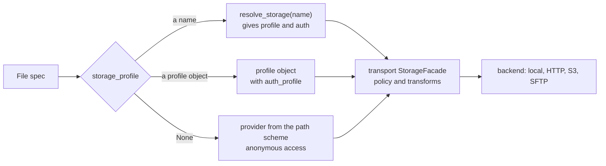

# Storage, profiles and transforms

mountainash-files does not open files or sockets itself. Every read and write goes through [mountainash-transport](https://docs.mountainash.io/mountainash-transport/), which picks a storage backend, authenticates, confines locations, and compresses or encrypts bytes on the way. A file spec carries the settings transport needs: `storage_profile`, `auth_profile`, `policy`, `transforms`, and on sources `infer`, `gzip` and `gpg`. The spec fields themselves are introduced in [File specs](../files-specs-and-formats/index.md#file-specs).

For every operation, files resolves the spec's profile fields, then builds a transport `StorageFacade` for the path with the profile, the auth profile and the location policy, and hands it the transform pipeline.



Backend behaviour, connections and credential storage are documented with transport and [mountainash-settings](https://docs.mountainash.io/mountainash-settings/).

## Storage and auth profiles

<!-- concept:40 -->

A storage profile tells transport which backend to use for a path and how to reach it: an S3 bucket and region, an SFTP host, or plain local disk. `FileSpec.storage_profile` accepts three kinds of value:

| Value | What happens |
|---|---|
| `None` (default) | Transport picks the provider from the path's scheme, with anonymous access. `sales.csv` is local disk and `https://...` is HTTP. |
| A profile object | Used as given. Build it yourself or get it from `mountainash_transport.resolve_storage()`. |
| A string | Treated as a profile name and resolved through `mountainash_transport.resolve_storage(name)`, which returns a storage profile and its paired auth profile. |

Source and sink specs resolve their own profiles, so `copy()` can read with one profile and write with another. A profile tells transport which backend to use; the backend's operations must also exist. The README lists HTTP, the S3 family and SFTP as implemented, and GCS, Azure, FTP, SMB and GitHub as profiles only, with backends still pending in transport.

<!-- concept:42 -->

An auth profile carries credentials: none, a password, a token, IAM, OAuth and so on. The classes come from mountainash-auth-client (`NoAuthProfile`, `PasswordAuthProfile`, `TokenAuthProfile` and others). With a profile object, pass the auth profile on `auth_profile`. With a profile name, the auth paired with that name is used, unless the spec also sets `auth_profile`; an explicit auth profile object always wins over the name-resolved one (`src/mountainash_files/_operations.py`).

<!-- concept:41 -->

### Named profiles

A named profile lives in a YAML file under `storage_profiles:`. Point `MOUNTAINASH_PROFILES_CONFIG` at the file and pass the name as `storage_profile`. This `profiles.yaml` declares a local profile with no authentication:

```yaml
storage_profiles:
  reports:
    provider: local
    auth:
      mode: none
```

```python
import os
import tempfile

import pyarrow as pa
from mountainash_files import FileSinkSpec, FileSourceSpec, parse, write

os.environ["MOUNTAINASH_PROFILES_CONFIG"] = "profiles.yaml"

with tempfile.TemporaryDirectory() as root:
    sink = FileSinkSpec(path=f"{root}/sales.csv", storage_profile="reports")
    write(sink, pa.table({"region": ["north", "south"], "total": [120, 95]}))
    result, = parse(FileSourceSpec(path=sink.path, storage_profile="reports"), output="pydata")
    print(result.data)
```

```text
[{'region': 'north', 'total': 120}, {'region': 'south', 'total': 95}]
```

To resolve the pair yourself, for example with explicit settings parameters, call `resolve_storage()` and pass both objects to the spec:

```python
from mountainash_settings import SettingsParameters
from mountainash_transport import resolve_storage

from mountainash_files import FileSourceSpec

parameters = SettingsParameters.create(config_files=["profiles.yaml"])
storage, auth = resolve_storage("reports", settings_parameters=parameters)
print(type(storage).__name__, type(auth).__name__)

source = FileSourceSpec(path="sales.csv", storage_profile=storage, auth_profile=auth)
```

```text
LocalStorageProfile NoAuthProfile
```

A name that is not configured raises transport's `ProfileNotFoundError`, for example `Cannot resolve storage profile 'reports': not found in configuration. Available: (none)`. Named profiles need the `[http]` extra, which installs transport's settings and auth stack.

Profiles whose configuration uses `secret:record.field` references need a secret store chosen by the application. Open the store, call `resolve_storage(name, settings_parameters=...)` with it, and pass the resolved pair to the spec. Files does not take ownership of the store. Secret stores belong to [mountainash-settings](https://docs.mountainash.io/mountainash-settings/); `docs/profiles.md` shows the full pattern.

## Location policy

<!-- concept:43 -->

By default a spec reads or writes wherever its `path` points. A `LocationPolicy` (from `mountainash_transport.location`) on the spec's `policy` field confines it. Files passes the policy to every facade it builds, so it applies to `parse`, `inspect_schema`, `stream`, `write`, `copy`, glob listing and template expansion. Transport raises `LocationNotAllowed` for anything outside it. Set a policy whenever paths, templates or `params` come from untrusted input.

| Field | Effect |
|---|---|
| `root` | Relative local paths resolve under this directory. `..` and symlinks that leave it are rejected. |
| `allowed_remote` | Map of scheme to allowed hosts or buckets, such as `{"s3": frozenset({"reports"})}`. With an active policy, a remote location not listed here is rejected. |
| `allow_unconfined` | `True` turns the policy off. |

```python
import tempfile

import pyarrow as pa
from mountainash_files import FileSinkSpec, FileSourceSpec, parse, write
from mountainash_transport.location import LocationNotAllowed, LocationPolicy

with tempfile.TemporaryDirectory() as tmp:
    policy = LocationPolicy(root=f"{tmp}/reports")
    write(FileSinkSpec(path="2026/sales.csv", policy=policy), pa.table({"region": ["north"], "total": [120]}))
    print(parse(FileSourceSpec(path="2026/sales.csv", policy=policy), output="pydata")[0].data)

    for path in ("../secrets.csv", "https://user:pw@data.example.com/sales.csv"):
        try:
            parse(FileSourceSpec(path=path, policy=policy))
        except LocationNotAllowed as exc:
            print(exc)
```

```text
[{'region': 'north', 'total': 120}]
location not allowed: ../secrets.csv (outside root)
location not allowed: https://data.example.com (remote not allowed)
```

The error message drops credentials embedded in a URL. `copy()` applies the source spec's policy to the source and the sink spec's policy to the destination (`tests/test_location_policy.py`).

## Remote sources

<!-- concept:50 -->

A path with a URL scheme is a remote source. With no storage profile, transport picks the provider from the scheme (`http`, `https`, `s3`, `sftp` and others) and connects anonymously. Pass a storage profile and auth profile when the location needs credentials or settings such as a region. Remote access needs an extra: `[http]` for URLs, `[s3]` for the S3 family and `[sftp]` for SFTP (see [Where files live](../files-specs-and-formats/index.md#where-files-live)).

Everything else on the spec works the same as for local files: format resolution from the suffix, globs where transport can list objects, transforms and `on_missing`. In this example a local `python -m http.server 8000` serves a directory that holds `sales.csv`:

```python
from mountainash_files import FileSourceSpec, parse
from mountainash_transport.location import LocationNotAllowed, LocationPolicy

url = "http://127.0.0.1:8000/sales.csv"

result, = parse(FileSourceSpec(path=url), output="pydata")
print(result.data)

allowed = LocationPolicy(allowed_remote={"http": frozenset({"127.0.0.1"})})
print(parse(FileSourceSpec(path=url, policy=allowed))[0].data.num_rows)

try:
    parse(FileSourceSpec(path=url, policy=LocationPolicy()))
except LocationNotAllowed as exc:
    print(exc)
```

```text
[{'region': 'north', 'total': 120}, {'region': 'south', 'total': 95}]
2
location not allowed: http://127.0.0.1 (remote not allowed)
```

`parse()` fetches remote Parquet with column projection through ranged reads, so it transfers only the footer and the selected columns; see [Parquet](../format-options/index.md#parquet). Storage failures surface as transport's exceptions, unchanged: `PathNotFoundError`, `AuthenticationError`, `PermissionDeniedError`, `StorageConnectionError` and `StorageError`.

## Compression and encryption transforms

<!-- concept:44 -->

A transform pipeline is a transport `Pipeline` of byte transforms, such as `Pipeline(Gzip())` or `Pipeline(GPG(...), Gzip())`. Set it on a spec's `transforms` field. Reads apply the pipeline to unwrap bytes (decompress, decrypt) before parsing; writes apply it to wrap the serialised bytes (compress, encrypt) before storing them. `copy()` unwraps with the source pipeline and wraps with the sink pipeline. `parse_bytes()` and `serialise_bytes()` never apply transforms.

Writes use only an explicit pipeline. A sink path ending in `.gz` without `transforms` is written uncompressed:

```python
import tempfile
from pathlib import Path

import pyarrow as pa
from mountainash_files import FileSinkSpec, write

with tempfile.TemporaryDirectory() as root:
    path = f"{root}/sales.csv.gz"
    write(FileSinkSpec(path=path), pa.table({"region": ["north"], "total": [120]}))
    print(Path(path).read_bytes()[:12])
```

```text
b'"region","to'
```

Format resolution skips transform suffixes, so `sales.csv.gz` still resolves to CSV ([How a format is chosen](../files-specs-and-formats/index.md#how-a-format-is-chosen)). Recognising the suffix does not, by itself, supply a decompressor; reads get one from the pipeline or from inference.

<!-- concept:45 -->

### Inference

On sources, `infer` decides whether transport builds a pipeline from the path's suffixes.

| `infer` | Behaviour |
|---|---|
| `None` (default) | Infer from suffixes only when `transforms` is not set. Archive reads default to no inference, so the archive layer handles decompression. |
| `True` | Infer from suffixes. Combining it with `transforms` raises `ValueError`. |
| `False` | No inference. With no `transforms`, encoded bytes pass through unchanged, which suits `copy()` and `stream()` of compressed files. |

Sink specs have no `infer` field, so the write side never infers.

<!-- concept:46 -->

### Gzip

`.gz` and `.gzip` suffixes infer transport's `Gzip` transform. The source's `gzip` field takes a configured `Gzip(...)` used for that inference, for example to change its `max_decompressed_bytes` limit (1 GiB by default in transport). It configures inference and has no effect on an explicit pipeline.

```python
import tempfile

import pyarrow as pa
from mountainash_files import FileSinkSpec, FileSourceSpec, parse, stream, write
from mountainash_transport import Gzip, Pipeline

with tempfile.TemporaryDirectory() as root:
    path = f"{root}/sales.csv.gz"
    write(
        FileSinkSpec(path=path, transforms=Pipeline(Gzip())),
        pa.table({"region": ["north", "south"], "total": [120, 95]}),
    )

    inferred, = parse(FileSourceSpec(path=path), output="pydata")
    explicit, = parse(FileSourceSpec(path=path, transforms=Pipeline(Gzip())), output="pydata")
    print(inferred.data == explicit.data, inferred.data[0])

    with stream(FileSourceSpec(path=path, infer=False)) as raw:
        print(raw.read(2))

    try:
        parse(FileSourceSpec(path=path, transforms=Pipeline(Gzip()), infer=True))
    except ValueError as exc:
        print(exc)
```

```text
True {'region': 'north', 'total': 120}
b'\x1f\x8b'
Cannot pass both infer=True and an explicit pipeline
```

For a gzip-compressed archive such as `data.zip.gz`, set `infer=True` so transport removes the outer gzip layer before ZIP extraction. Do not combine gzip inference with `archive=GzipCompression()`, which unwraps the same layer; see [Gzip archives and decompression limits](../selecting-files/index.md#gzip-archives-and-decompression-limits).

<!-- concept:47 -->

### GPG encryption

`.gpg`, `.pgp` and `.asc` suffixes infer transport's `GPG` transform, but only when the source's `gpg` field holds a configured `GPG(...)` instance. Without one, transport raises `ValueError` before reading. For an explicit pipeline, list every transform the file needs.

```python
from mountainash_files import FileSourceSpec, parse
from mountainash_transport import GPG, Gzip, Pipeline

try:
    parse(FileSourceSpec(path="sales.csv.gz.gpg"))
except ValueError as exc:
    print(exc)

inferred = FileSourceSpec(path="sales.csv.gz.gpg", gpg=GPG(gnupghome="/path/to/keyring"))
explicit = FileSourceSpec(
    path="sales.csv.gz.gpg",
    transforms=Pipeline(GPG(gnupghome="/path/to/keyring"), Gzip()),
)
```

```text
path 'sales.csv.gz.gpg' has a .gpg suffix; pass gpg=GPG(...) to infer
```

Parsing either spec decrypts, decompresses, then parses. Decryption needs the `[encryption]` extra, GnuPG and the right keys; `GPG` also takes `recipients`, `key_file`, `passphrase`, `armor` and `always_trust`. Transport's GPG transform buffers internally, so encrypted sources are held in memory whichever access mode applies.

## Stream access

<!-- concept:48 -->

`stream(source, access=...)` returns a raw byte stream, with transforms applied and no parsing (see [Copying bytes and opening streams](../reading-and-writing/index.md#copying-bytes-and-opening-streams)). The `access` argument passes to transport unchanged and chooses how the bytes are acquired:

| `access` | Acquisition | Seekable | Transforms |
|---|---|---|---|
| `"sequential"` (default) | Demand-driven streaming, no whole-object buffer | Remote handles are forward-only; local handles stay seekable | Supported |
| `"random"` | Byte-range fetches with caching | Yes | Rejected when the effective pipeline is not empty |
| `"buffered"` | Reads and decodes the whole object first | Yes, in decoded bytes | Supported |

`stream()` has no fallback. If transport refuses the combination, the error propagates. Python's `http.server` does not serve byte ranges, so `access="random"` fails against it:

```python
from mountainash_files import FileSourceSpec, stream
from mountainash_transport import RangeNotSupportedError, RangePolicy

source = FileSourceSpec(path="http://127.0.0.1:8000/sales.csv")

with stream(source) as handle:  # access="sequential"
    print(handle.seekable(), handle.read(13))

with stream(source, access="buffered") as handle:
    handle.seek(-9, 2)
    print(handle.seekable(), handle.read())

try:
    with stream(source, access="random", range_policy=RangePolicy("none")) as handle:
        handle.read()
except RangeNotSupportedError as exc:
    print(type(exc).__name__, "|", exc)
```

```text
False b'region,total\n'
True b'south,95\n'
RangeNotSupportedError | Expected 206, received 200
```

`parse()` and `inspect_schema()` choose the mode themselves, per format: Parquet with a column projection asks for `"random"`, and a bounded CSV or NDJSON schema discovery asks for `"sequential"`. When a transform applies or the backend refuses ranges, they fall back to whole-object bytes. [The read pipeline](../architecture/index.md#the-read-pipeline) describes that routing.

<!-- concept:49 -->

### Range policy

`range_policy` takes a transport `RangePolicy` that controls caching for `access="random"`: `RangePolicy(cache="readahead", block_size=1048576, max_blocks=32)` is the library default, and the caches are `"readahead"`, `"none"`, `"blockcache"` and `"bytes"`. A supplied policy replaces the profile's `RANGE_CACHE`, `RANGE_BLOCK_SIZE` and `RANGE_MAX_BLOCKS` settings. Passing it with another access mode, or using `"random"` with transforms, raises transport's `ValueError`:

```python
import tempfile

from mountainash_files import FileSinkSpec, FileSourceSpec, stream, write
from mountainash_transport import Gzip, Pipeline, RangePolicy

with tempfile.TemporaryDirectory() as root:
    path = f"{root}/sales.csv.gz"
    write(FileSinkSpec(path=path, transforms=Pipeline(Gzip())), b"region,total\nnorth,120\n")

    for access, policy in (("random", None), ("sequential", RangePolicy("none"))):
        try:
            with stream(FileSourceSpec(path=path), access=access, range_policy=policy):
                pass
        except ValueError as exc:
            print(access, "|", exc)

    with stream(FileSourceSpec(path=path, infer=False), access="random") as handle:
        print(handle.read(2))
```

```text
random | access='random' cannot be combined with transforms
sequential | range_policy requires access='random'
b'\x1f\x8b'
```

`parse()` and `inspect_schema()` pass no range policy, so the profile settings or transport's defaults apply to them. Cache tuning guidance is in the [mountainash-transport documentation](https://docs.mountainash.io/mountainash-transport/).
